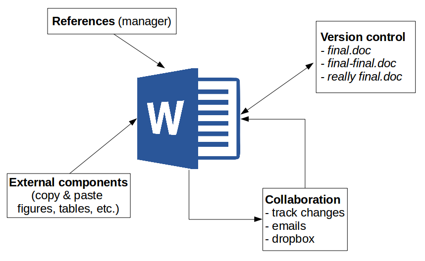

```{=html}
<style>
/* Sistema visual local: solo distingue funciones pedagógicas. */
.rv-question {
  margin: .9rem 0 .65rem;
  padding: .7rem .95rem;
  border-left: 3px solid #607d86;
  background: var(--bs-tertiary-bg, rgba(118, 134, 143, .065));
  border-radius: 0 .35rem .35rem 0;
}
.rv-question > :first-child { margin-top: 0; }
.rv-question > :last-child { margin-bottom: 0; }
.rv-question p:first-child { font-size: .82rem; color: var(--bs-secondary-color, #657681); letter-spacing: .025em; margin-bottom: .3rem; }
.rv-question p:last-child { font-weight: 500; }
.rv-groups {
  display: grid;
  grid-template-columns: repeat(2, minmax(0, 1fr));
  gap: .65rem;
  margin: .65rem 0 .35rem;
}
.rv-group {
  min-width: 0;
  padding: .65rem .85rem;
  border: 1px solid var(--bs-border-color, #d5dcde);
  border-radius: .35rem;
  background: var(--bs-tertiary-bg, rgba(118, 134, 143, .045));
}
.rv-group p { margin: 0; }
.rv-group p + p { margin-top: .25rem; }
.rv-group p:first-child { font-size: .9rem; }
.rv-order {
  margin: .15rem 0 1.15rem;
  padding: .2rem .15rem;
  color: var(--bs-body-color, inherit);
  font-size: .92rem;
}
.rv-order > :first-child, .rv-order > :last-child { margin: 0; }
.rv-activity, .rv-practice {
  margin: .75rem 0 .55rem;
  border-left: 2px solid var(--bs-secondary-color, #83939a);
  padding: .25rem 0 .25rem .85rem;
}
.rv-activity > :first-child, .rv-practice > :first-child { margin-top: 0; }
.rv-activity > :last-child, .rv-practice > :last-child { margin-bottom: 0; }
.rv-practice p { margin: .45rem 0; }
.rv-practice p + p { padding-top: .25rem; }
/* Material de apoyo durante el intento: soporte, nunca solución. */
.rv-formulas {
  margin: .7rem 0 .85rem;
  padding: .6rem .85rem;
  border: 1px solid var(--bs-border-color, #d5dcde);
  border-radius: .35rem;
}
.rv-formulas > :first-child { margin-top: 0; }
.rv-formulas > :last-child { margin-bottom: 0; }
.rv-formulas p { margin: .4rem 0; }
.rv-formulas strong { font-weight: 650; }
.rv-answer.callout { margin: .5rem 0 .9rem; }
.rv-answer.callout .callout-header { font-weight: 650; }
/* Igualamos el tamaño del texto dentro de los bloques al texto general de la página. */
#quarto-content main.content .callout .callout-body,
#quarto-content main.content .callout .callout-body p,
#quarto-content main.content .callout .callout-body li,
#quarto-content main.content .callout .callout-body ul,
#quarto-content main.content .callout .callout-body ol {
  font-size: 1rem;
  line-height: 1.6;
}
.rv-answer.callout p:has(> strong:first-child) { margin-top: .65rem; }
.rv-answer.callout p:first-child { margin-top: .1rem; }
.rv-answer.callout p:last-child { margin-bottom: .25rem; }
.cell-output-display img, .quarto-figure img { max-width: 100%; height: auto; }
/* Párrafos justificados, sin afectar títulos, tablas ni el índice lateral.
   Se limita el ajuste al cuerpo de esta página. */
@media (min-width: 768px) {
  #quarto-content main.content p {
    text-align: justify;
    text-justify: inter-word;
    hyphens: auto;
  }
  /* Etiquetas cortas y comparaciones: más legibles alineadas a la izquierda. */
  #quarto-content main.content .rv-group p,
  #quarto-content main.content .rv-order p,
  #quarto-content main.content .rv-question p:first-child,
  #quarto-content main.content .rv-formulas p,
  #quarto-content main.content .callout-title p,
  #quarto-content main.content figcaption p {
    text-align: left;
    hyphens: none;
  }
}
/* En móvil evitamos huecos entre palabras en columnas estrechas. */
@media (max-width: 767.98px) {
  #quarto-content main.content p { text-align: left; hyphens: none; }
}
@media (max-width: 700px) {
  .rv-groups { grid-template-columns: 1fr; gap: .4rem; }
  .rv-question { padding: .65rem .7rem; }
  .rv-group { padding: .55rem .7rem; }
  .rv-activity, .rv-practice { padding-left: .65rem; }
}
</style>
```

```{r}
#| label: setup
#| include: false
library(ggplot2)
library(plotly)
library(DT)

# Submuestra CASEN 2024 del repositorio de datos del curso
url_datos <- paste0("https://raw.githubusercontent.com/",
                    "cursos-metodos-facso/datos-ejemplos/main/casen_barrio2024.rdata")
load(url(url_datos))  # crea el objeto datos_casen

# Cifras que se reportan en la página (todas calculadas, ninguna escrita a mano)
n_total   <- nrow(datos_casen)
n_ingreso <- sum(!is.na(datos_casen$ingreso_trabajo))
r         <- cor(datos_casen$escolaridad, datos_casen$ingreso_trabajo, use = "complete.obs")
r_edad    <- cor(datos_casen$escolaridad, datos_casen$edad, use = "complete.obs")
jornada   <- subset(datos_casen, horas_trabajo >= 30)
r_jornada <- cor(jornada$escolaridad, jornada$ingreso_trabajo, use = "complete.obs")

# Formato chileno: separador de miles con punto y decimales con coma
miles <- function(x) format(x, big.mark = ".", decimal.mark = ",")
coma  <- function(x, d = 2) format(round(x, d), nsmall = d, decimal.mark = ",")
```

# Introducción {#inicio}

Hasta ahora hemos analizado datos en R y comunicado los resultados por separado. En esta sesión aprenderemos a **escribir el informe y el análisis en un mismo documento**, de modo que cada gráfico y cada cifra se calculen al generarlo. La herramienta es **Quarto**, que viene incluido en Positron.

Al finalizar la clase, generamos un **informe reproducible** que responda la siguiente pregunta: 

::: {.rv-question}
**Pregunta de investigación del informe**

¿Se asocia la escolaridad con el ingreso del trabajo en Chile?
:::

::: {#capsula-quarto}
**Cápsula de apoyo · Documentos dinámicos con Quarto en Positron**

En este video revisamos los contenidos de esta sesión. Puedes verlo antes del taller o usarlo para repasar.



[Ver la cápsula directamente en YouTube](https://youtu.be/tdKGlvVz5_Y).
:::

# A · Escribir en texto plano {#parte-a}

## El problema de cortar y pegar {#cortar-pegar}

El flujo habitual para escribir un informe con resultados estadísticos separa dos programas: el análisis se hace en un software estadístico (por ejemplo, R a través de Positron) y el texto en un procesador de texto (Word, Google Docs). Los resultados viajan de uno a otro **copiando y pegando**.

{width="70%" fig-align="center"}

Este flujo tiene tres desventajas:

- **Barrera de pago o licencia** para acceder a los contenidos y editarlos.
- **Difícil versionamiento:** cuesta registrar quién hizo qué cambio, lo que complica la colaboración.
- **No es reproducible:** el documento no contiene el código que produjo los resultados, así que nadie puede rastrear de dónde salió cada número.

::: {.rv-activity}
**Imaginemos el siguiente caso**: Usted está haciendo un informe sobre la correlación entre escolaridad e ingreso del trabajo a partir de datos de CASEN y obtuvo $r=`r coma(r)`$. Copió ese número, el gráfico de nubes y una tabla en un informe escrito en Word. Sin embargo, con su equipo de trabajo luego deciden que es mejor analizar sólo a quienes trabajan **30 horas o más a la semana**. ¿Qué partes de informe tendría que rehacer a mano?

1. Cambia el n, el coeficiente, y su valor p.
2. El gráfico
3. La tabla
4. Asimismo, debe corregir todas las menciones en el texto (En la sección de resultados, pero también en el resumen y en las conclusiones). **Basta olvidar una para que el informe se contradiga a sí mismo**
5. Además, el documento **no guarda el código**, por lo que ni el lector, ni su equipo ni usted mismo (en un tiempo más) podrán trazar de dónde salió cada número

**Idea central: donde hay cortar y pegar, no hay reproducibilidad.**

:::

## Texto plano y marcas de edición {#texto-plano}

La alternativa es la **escritura en texto plano**: se escribe en un editor de texto (en nuestro caso, Positron) un archivo que contiene solo caracteres, sin formato oculto. El formato se indica con **marcas de edición**, y un programa convierte después ese texto de entrada (*input*) en el documento final (*output*).

:::: {.rv-groups}
::: {.rv-group}
**Input: lo que se escribe**

`## Resultados` y `**asociación positiva**`
:::
::: {.rv-group}
**Output: lo que lee el lector**

Un título de sección y el texto **asociación positiva** en negrita.
:::
::::

Esta forma de escribir es **independiente de programas comerciales y plataformas**, pone el foco en el **contenido antes que en el formato** y permite obtener **distintos formatos finales** desde un mismo archivo. Entre las principales alternativas se encuentran **LaTeX** y **Markdown**:

| | Control del formato | Marcas de edición | Formatos de salida |
|:--|:--:|:--:|:--:|
| **LaTeX** (años 80) | Alto | Muchas y complejas | Principalmente PDF |
| **Markdown** (2004) | Menor | Pocas y simples | HTML, PDF, Word y otros |

Usaremos **Markdown**, creado por John Gruber y Aaron Swartz con una filosofía simple: que el texto con marcas sea legible incluso sin convertirlo.

::: {.rv-formulas}
**Marcas de Markdown más usadas**

| Se escribe | Se obtiene |
|:--|:--|
| `## Resultados` | Un título de sección (`#` título, `##` subtítulo…) |
| `**asociación positiva**` | **asociación positiva** |
| `*Pearson*` | *Pearson* |
| `- primer punto` | Una lista con viñetas |
| `[CASEN](https://...)` | Un enlace |
| `` | Una imagen |
:::

# B · Quarto {#parte-b}

## Documentos dinámicos {#documentos-dinamicos}

Markdown resuelve la escritura, pero los resultados siguen viniendo de otro lado. Un **documento dinámico** integra en un mismo archivo de texto plano **el texto y el código de análisis**: al generar el documento, el código se ejecuta y sus resultados (gráficos, tablas, cifras) se insertan en el lugar correspondiente. Se elimina el cortar y pegar, y corregir un análisis es tan simple como volver a generar el documento.

[**Quarto**](https://quarto.org/) es un sistema de publicación científica y técnica **de código abierto** para producir documentos dinámicos:

- Es el sucesor de **RMarkdown**: misma lógica, más formatos y más lenguajes (R, Python, Julia).
- Se escribe en **texto plano**, en archivos con extensión `.qmd`.
- Un mismo archivo puede producir HTML, PDF, Word, presentaciones, sitios web y libros.
- **Viene incluido en Positron**: no hay que instalar nada adicional.

## ¿Cómo funciona? {#como-funciona}

Al generar (o *renderizar*) un documento, Quarto encadena dos programas: **knitr** ejecuta el código R y escribe sus resultados en un archivo Markdown, y **Pandoc** convierte ese Markdown al formato de salida.

```{mermaid}
%%| fig-width: 7
flowchart LR
  A[".qmd<br>texto + código"] --> B["knitr<br>ejecuta el código R"]
  B --> C[".md<br>texto + resultados"]
  C --> D["Pandoc<br>convierte"]
  D --> E["HTML"]
  D --> F["PDF"]
  D --> G["Word"]
```

Todo esto ocurre al presionar un solo botón en Positron: **Preview**, o su atajo, `Ctrl/Cmd + Shift + K`.

{width="70%" fig-align="center"}

## Anatomía de un archivo `.qmd` {#anatomia}

Un archivo `.qmd` tiene dos partes: un **encabezado YAML** y un **cuerpo**. En el cuerpo va todo el contenido del documento, es decir, **texto** y **código**:

````markdown
---
title: "Escolaridad e ingresos en Chile"
author: "Nombre Apellido"
format: html
lang: es
---

## Introducción

Este informe usa datos de la **CASEN 2024**.

```{r}`r ''`
#| label: datos
load("input/data/casen_barrio2024.rdata")
```
````


::: {.callout-note collapse="false" appearance="minimal" .rv-answer title="Anatomía de un .qmd"}

**1. Encabezado YAML.** Va al inicio, entre dos líneas de tres guiones (`---`). Define el título, el autor y el formato de salida; cada campo lleva dos puntos. Además, en el YAML se pueden agregar otras especificaciones sobre el documento, como el archivo de bibliografía y su formato de citas, o la configuración de las salidas HTML y PDF.

**2. Cuerpo.** Todo lo que va después del encabezado. Combina dos elementos:

- **Texto en Markdown:** el título de sección y la frase con negrita; es lo que lee el lector.
- **Bloques de código (*chunks*):** se abren con tres comillas invertidas y `{r}`, y se cierran con tres comillas invertidas. Su contenido se ejecuta como código R al generar el documento.

:::

::: {.callout-important title="La pieza fundamental: el chunk"}
La pieza fundamental de un documento dinámico es el **bloque de código (*chunk*)**, que se inserta dentro de un documento escrito en Markdown. Es lo que permite que los resultados se calculen al generar el documento, en lugar de copiarse y pegarse.
:::

::: {.callout-tip title="Opciones del bloque"}
La línea `#| label: datos` es una **opción del bloque**: le da un nombre. Las opciones se escriben al inicio del bloque con `#|` y controlan, por ejemplo, si el lector ve el código o solo el resultado. Las veremos en detalle en el taller.
:::

# C · Taller: un informe reproducible en Positron {#parte-c}

Usaremos una submuestra aleatoria de la **CASEN 2024** con `r miles(n_total)` personas de 18 años o más.

| Variable | Descripción |
|:--|:--|
| `escolaridad` | Años de escolaridad |
| `ingreso_trabajo` | Ingreso mensual del trabajo (\$) |
| `edad` | Edad en años |


## Preparar la carpeta y el documento {#ej1}

En Positron, **la carpeta es el proyecto**: no se necesita un archivo `.Rproj`. Todo lo que el informe necesita (datos, documento y resultados) vive dentro de una misma carpeta, y el código se refiere a los archivos con **rutas relativas** a ella. Por ejemplo, `input/data/casen_barrio2024.rdata` funciona en cualquier computador que tenga la carpeta. Así, cualquier persona que reciba la carpeta puede generar el informe sin modificar nada.

Dentro de la carpeta conviene separar los archivos en subcarpetas: `input/data` guarda los datos que usa el análisis y `output` los resultados que se generan (gráficos, tablas). Esta separación ayuda a mantener un flujo de trabajo ordenado.

Todo lo necesario para generar un documento en Quarto se puede resumir en 3 pasos:

1. **Abrir la carpeta como proyecto:** *File › Open Folder...*

2. **Crear el documento:** *File › New File...* › **Quarto Document**

3. **Generar el documento:** botón **Preview** o `Ctrl/Cmd + Shift + K`


**Ejercicio**

A) Crea una carpeta `mi-informe` con las subcarpetas `input/data` y `output`, y ábrela en Positron.

B) Crea `informe.qmd` en la raíz de la carpeta y escribe un encabezado YAML con título, autor, formato HTML e idioma español.

C) Escribe un subtítulo `## Introducción` y una frase en Markdown con una palabra en negrita. Genera el documento con **Preview**.


::: {.callout-note collapse="true" appearance="minimal" .rv-answer title="Ver pauta · Ejercicio 1"}

**A. Estructura de carpetas** La carpeta del proyecto queda así:

```{.txt}
mi-informe/
├── informe.qmd
├── input/
│   └── data/
│       └── casen_barrio2024.rdata # si la data estuviera almacenada en el computador
└── output/
```

**B. Documento y encabezado** El encabezado va al inicio del archivo:

```yaml
---
title: "Escolaridad e ingresos en Chile"
author: "Nombre Apellido"
format: html
lang: es
---
```

`lang: es` traduce al español los textos automáticos, como «Figura» o «Tabla».

**C. Vista previa** Bajo el encabezado:

```markdown
## Introducción

Este informe analiza la relación entre **escolaridad** e **ingresos**
con datos de la *CASEN 2024*.
```

Al presionar **Preview**, el documento aparece en el panel **Viewer** de Positron y `informe.html` queda guardado junto a `informe.qmd`.
:::

## Cargar los datos {#ej2}

Ahora agregamos el primer **bloque de código**. Todo lo que está dentro se ejecuta como código R al generar el documento; lo que está fuera es texto. Para insertar un *chunk* en el documento deben utilizar el atajo `Ctrl/Cmd + Shift + I`.

El código dentro de un chunk funciona igual que en un script de R: pueden ejecutar una línea con Ctrl/Cmd + Enter o el chunk completo con Ctrl/Cmd + Shift + Enter. **Esto no genera el documento final**; solo permite comprobar que el código funciona. **Si el código contiene un error, la renderización del documento se detendrá**. 

**Ejercicio**

A) Descargue la base de datos desde [este enlace](https://raw.githubusercontent.com/cursos-metodos-facso/datos-ejemplos/main/casen_barrio2024.rdata) y guárdela en la carpeta `input/data` de su proyecto. Luego, inserte un *chunk* en su documento que cargue el paquete `tidyverse` y la base de datos con una **ruta relativa**:

```{{r}}
load("input/data/casen_barrio2024.rdata")
```

B) Inserte un segundo *chunk*. Calcule el total de casos en la base. Además, calcule el total de casos válidos en `ingresos_trabajos` con el código de más abajo. Luego, reporte sus hallazgos. 

```{{r}}
nrow(datos_casen)                          # total de personas
sum(!is.na(datos_casen$ingreso_trabajo))   # personas con ingreso válido
```

::: {.callout-note collapse="true" appearance="minimal" .rv-answer title="Ver pauta · Ejercicio 2"}

**A. Cargar datos y librerías en un chunk**

```{{r}}
#| label: datos
library(tidyverse)
load("input/data/casen_barrio2024.rdata")  # crea el objeto datos_casen
```

**B. Analizar y reportar datos**

```{{r}}
#| label: casos
nrow(datos_casen)                          # total de personas
sum(!is.na(datos_casen$ingreso_trabajo))   # personas con ingreso válido
```

La base tiene **`r miles(n_total)` personas**, de las cuales **`r miles(n_ingreso)`** (`r coma(100 * n_ingreso / n_total, 0)`%) reportan ingreso del trabajo: algo más de la mitad.

:::

## Opciones de los bloques de código {#ej3}

En la mayoría de los informes, vamos a querer reportar **solo los resultados**. Sin embargo, en algunos documentos técnicos o pedagógicos (como este), nos interesa mostrar también el **código que genera el documento**. En Quarto, esta decisión se controla a través de las **opciones de bloque**. Estas se insertan en el encabezado del *chunk*, precedidas por un `#|`.

```{{r}} 
#| echo: false
#| eval: false
#| include: false
#| warning: false
#| fig-cap: "Grafico 1"
#| label: fig-graf-1

# Acá va el código...
```

::: {.rv-formulas}
**Opciones de los bloques de código**

| Opción | Qué hace |
|:--|:--|
| `echo: false` | Muestra el resultado y oculta el código |
| `eval: false` | Muestra el código sin ejecutarlo |
| `include: false` | Ejecuta, pero no muestra ni código ni resultado |
| `warning: false` | Oculta las advertencias |
| `fig-cap: "..."` | Agrega una leyenda a la figura |
| `label: fig-...` | Nombra el bloque y permite referirse a la figura |
:::


**Ejercicio**

A) En un nuevo *chunk*, inserte el siguiente código que crea una gráfico de dispersión entre `escolaridad` en el eje X e `ingreso_trabajo` en el eje Y, con una recta de regresión.

```{{r}}
ggplot(datos_casen,
       aes(x = escolaridad, y = ingreso_trabajo)) +
  geom_jitter(alpha = 0.3, width = 0.3) +
  geom_smooth(method = "lm", se = FALSE) +
  labs(x = "Años de escolaridad",
       y = "Ingreso del trabajo ($)")
```

B) Etiquete el código como `fig-dispersion`, agregue una leyenda y haga que el informe muestre el gráfico, pero no el código ni las advertencias.


::: {.callout-note collapse="true" appearance="minimal" .rv-answer title="Ver pauta · Ejercicio 3"}

**Crear el gráfico y usar opciones de bloque**

```{{r}}
#| label: fig-dispersion
#| fig-cap: "Escolaridad e ingreso del trabajo"
#| echo: false
#| warning: false
ggplot(datos_casen,
       aes(x = escolaridad, y = ingreso_trabajo)) +
  geom_jitter(alpha = 0.3, width = 0.3) +
  geom_smooth(method = "lm", se = FALSE) +
  labs(x = "Años de escolaridad",
       y = "Ingreso del trabajo ($)")
```

`warning: false` evita mostrar el aviso de `ggplot()` sobre las filas con `NA`, que no le interesa al lector. El resultado se verá así (aquí, con el eje vertical acotado a \$3.000.000 para facilitar la lectura):

```{r}
#| label: fig-dispersion-taller
#| fig-cap: "Escolaridad e ingreso del trabajo, CASEN 2024 (submuestra). Personas con ingreso del trabajo; eje vertical acotado a $3.000.000."
#| fig-width: 7.8
#| fig-height: 4.2
ggplot(datos_casen, aes(x = escolaridad, y = ingreso_trabajo)) +
  geom_jitter(alpha = 0.3, width = 0.3, colour = "#526e75") +
  geom_smooth(method = "lm", se = FALSE, colour = "#284958", linewidth = 1.1) +
  scale_y_continuous(labels = scales::label_number(big.mark = ".", decimal.mark = ",")) +
  coord_cartesian(ylim = c(0, 3e6)) +
  labs(x = "Años de escolaridad", y = "Ingreso del trabajo ($)") +
  theme_minimal(base_size = 13) +
  theme(panel.grid.minor = element_blank())
```

:::


::: {.callout-tip}

Al escribir `La @fig-dispersion muestra...`, el documento muestra «La Figura 1 muestra…» con un enlace a la figura; la etiqueta debe comenzar con `fig-` para que Quarto la numere. 
:::


## Código en línea {#ej4}

Además del código en bloque, Quarto permite escribir **código en línea**.   El **código en línea** se escribe dentro de una frase, entre comillas invertidas y comenzando con `r`. Al generar el documento, Quarto reemplaza el código por su resultado.

:::: {.rv-groups}
::: {.rv-group}
**Lo que se escribe**

`` La correlación es `r '\x60r round(r, 2)\x60'`. ``
:::
::: {.rv-group}
**Lo que lee el lector**

La correlación es `r round(r, 2)`.
:::
::::

::: {.rv-formulas}
**Apoyo · Correlación en R**

**Coeficiente de Pearson:** `cor(x, y, use = "complete.obs")`

`use = "complete.obs"` excluye los casos con `NA` en alguna de las dos variables. Sin esta opción, basta un valor perdido para que el resultado sea `NA`.

**Redondear:** `round(valor, 2)`
:::

**Ejercicio**

A) Agregue un *chunk* con la etiqueta `correlacion`. Calcule la correlación entre `escolaridad` e `ingreso_trabajo` y guárdela en un objeto `r`.

B) Reporte e interprete el resultado utilizando código en línea

C) Genere el documento y verifique que el coeficiente correcto aparece en el texto

D) Reemplace `ingreso_trabajo` por `edad` en `cor()`, y vuelva a renderizar el documento. ¿Cambió el número del texto?

::: {.callout-note collapse="true" appearance="minimal" .rv-answer title="Ver pauta · Ejercicio 4"}

**A. Calcular R**

```{{r}}
#| label: correlacion
r <- cor(datos_casen$escolaridad, datos_casen$ingreso_trabajo,
         use = "complete.obs")
```

**B. Reportar e interpretar**

```markdown
La correlación entre escolaridad e ingreso del trabajo es `r '\x60r round(r, 2)\x60'`.
```

y al generarlo se lee: la correlación entre escolaridad e ingreso del trabajo es **`r round(r, 2)`**.

**Interpretación modelo.** «Existe una asociación **positiva y moderada** entre escolaridad e ingreso del trabajo ($r=`r coma(r)`$): las personas con más años de escolaridad tienden a tener mayores ingresos. Esta asociación **no demuestra causalidad** y considera solo a quienes trabajan».

**C. Renderizar.** Con **Render on Save** activado (barra del editor), el informe se actualiza cada vez que guardas el archivo.

Observe que **ninguna cifra de esta página se escribió a mano**: el tamaño de la muestra, los casos válidos y cada $r$ se calculan cada vez que se genera.


**D. Volver a renderizar**

La frase con código en línea muestra el nuevo valor sin editar el texto. Ahora $r=`r coma(r_edad)`$, una asociación **negativa y moderada**: las personas de mayor edad tienden a tener menos años de escolaridad.

:::


::: {.callout-note collapse="true" appearance="simple" title="Para profundizar (opcional): ¿qué más se puede hacer con Quarto?"}

**Reportes multiformato**

El mismo sistema que usamos para el informe sirve para muchos otros productos. **Esta página y todas las clases del curso** están escritas en archivos `.qmd`.

Es más, es posible producir **varios formatos desde un mismo archivo.** Basta con declararlos en el encabezado; en Positron, **Quarto: Render Document** genera todos los formatos declarados:

```yaml
---
title: "Escolaridad e ingresos"
format:
  html: default   # página web (la más rápida)
  pdf: default    # vía LaTeX o Typst
  docx: default   # Word, para quien lo pida
---
```

**Referencias cruzadas, referencias bibliográficas y ecuaciones**

| Elemento | ¿Qué es? | ¿Cómo se usa? | ¿Por qué es útil? |
|---|---|---|---|
| **Referencias cruzadas** | Enlaces internos que remiten a figuras, tablas, ecuaciones o secciones del propio documento. | Se asigna una etiqueta con un prefijo (`fig-`, `tbl-`, `eq-`, `sec-`), por ejemplo `#| label: fig-dispersion` dentro del *chunk*, y se cita en el texto con `@fig-dispersion`. | Quarto numera automáticamente los elementos y actualiza las referencias si cambia el orden, evitando errores de numeración manual. |
| **Referencias bibliográficas** | Citas a fuentes externas (artículos, libros, etc.) almacenadas en un archivo de bibliografía. | Se declara el archivo en el encabezado YAML (`bibliography: referencias.bib`) y se cita con `[@clave]` o `@clave`. El estilo se define con `csl:`. | Genera automáticamente las citas y la lista de referencias al final del documento, con un formato consistente (APA, Chicago, etc.). |
| **Ecuaciones** | Expresiones matemáticas escritas en sintaxis LaTeX. | En línea con `$...$` y en bloque con `$$...$$`. | Permite escribir notación matemática con calidad tipográfica y vincularla al texto mediante referencias cruzadas. |

**Más allá de los informes y reportes**

Quarto además nos permite crear otro tipos de productos, tales como presentaciones, dashboards, sitios webs y libros. 


| Producto | Cómo |
|:--|:--|
| Presentaciones | `format: revealjs` (también PowerPoint y Beamer) |
| Sitios web y libros | Varios `.qmd` y un archivo `_quarto.yml`; por ejemplo, [la página del curso](https://correlacional.metodos-facso.org) o [R for Data Science](https://r4ds.hadley.nz) |
| Dashboards y aplicaciones | `format: dashboard`; Shiny u Observable JS para filtros y controles, como [VISLATAM](https://ocs-coes.shinyapps.io/visualizador-la/) |

Se pueden encontrar ejemplos de todos estos usos en el [sitio web oficial de Quarto](https://quarto.org/docs/gallery/)

:::


# Cierre {#cierre}


Un **documento dinámico** integra texto y código en un solo archivo de texto plano. El informe que construimos se genera completo a partir de los datos: si corregimos la base o cambiamos el filtro, basta con volver a generarlo para que el gráfico y cada cifra se actualicen.

| Elemento | Para qué sirve | Ejemplo |
|:--|:--|:--|
| Encabezado YAML | Título, autor y formato de salida | `format: html` |
| Markdown | Texto con formato para el lector | `**negrita**`, `## Sección` |
| Bloque de código | Código R que se ejecuta al generar | `#| label: datos` |
| Opciones del bloque | Qué ve el lector de cada bloque | `#| echo: false` |
| Código en línea | Cifras dentro del texto | `` `r '\x60r round(r, 2)\x60'` `` |

::: {.callout-tip collapse="false" appearance="minimal" title="Recursos"}

- [Quarto en Positron](https://quarto.org/docs/tools/positron/)
- [Guía de Markdown](https://www.markdownguide.org/cheat-sheet/)
- [Tutorial de Markdown en español](https://www.markdowntutorial.com/es/)
- [Better BibTeX para Zotero](https://retorque.re/zotero-better-bibtex/)
- [Galería de ejemplos de Quarto](https://quarto.org/docs/gallery/)
- [LISA: protocolos para investigación reproducible](https://lisa-coes.com/)

:::
