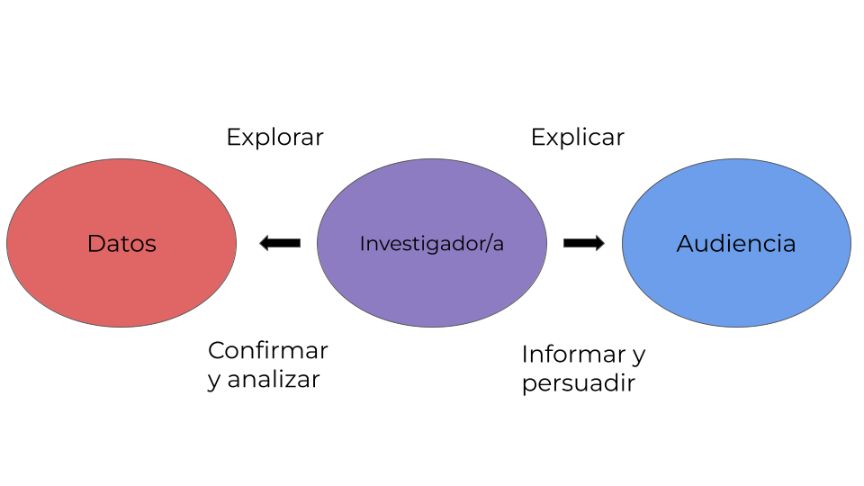

```{=html}
<style>
/* Sistema visual local: solo distingue funciones pedagógicas. */
.rv-question {
  margin: .9rem 0 .65rem;
  padding: .7rem .95rem;
  border-left: 3px solid #607d86;
  background: var(--bs-tertiary-bg, rgba(118, 134, 143, .065));
  border-radius: 0 .35rem .35rem 0;
}
.rv-question > :first-child { margin-top: 0; }
.rv-question > :last-child { margin-bottom: 0; }
.rv-question p:first-child { font-size: .82rem; color: var(--bs-secondary-color, #657681); letter-spacing: .025em; margin-bottom: .3rem; }
.rv-question p:last-child { font-weight: 500; }
.rv-groups {
  display: grid;
  grid-template-columns: repeat(2, minmax(0, 1fr));
  gap: .65rem;
  margin: .65rem 0 .35rem;
}
.rv-group {
  min-width: 0;
  padding: .65rem .85rem;
  border: 1px solid var(--bs-border-color, #d5dcde);
  border-radius: .35rem;
  background: var(--bs-tertiary-bg, rgba(118, 134, 143, .045));
}
.rv-group p { margin: 0; }
.rv-group p + p { margin-top: .25rem; }
.rv-group p:first-child { font-size: .9rem; }
.rv-order {
  margin: .15rem 0 1.15rem;
  padding: .2rem .15rem;
  color: var(--bs-body-color, inherit);
  font-size: .92rem;
}
.rv-order > :first-child, .rv-order > :last-child { margin: 0; }
.rv-activity, .rv-practice {
  margin: .75rem 0 .55rem;
  border-left: 2px solid var(--bs-secondary-color, #83939a);
  padding: .25rem 0 .25rem .85rem;
}
.rv-activity > :first-child, .rv-practice > :first-child { margin-top: 0; }
.rv-activity > :last-child, .rv-practice > :last-child { margin-bottom: 0; }
.rv-practice p { margin: .45rem 0; }
.rv-practice p + p { padding-top: .25rem; }
/* Fórmulas disponibles durante el intento: soporte, nunca solución. */
.rv-formulas {
  margin: .7rem 0 .85rem;
  padding: .6rem .85rem;
  border: 1px solid var(--bs-border-color, #d5dcde);
  border-radius: .35rem;
}
.rv-formulas > :first-child { margin-top: 0; }
.rv-formulas > :last-child { margin-bottom: 0; }
.rv-formulas p { margin: .4rem 0; }
.rv-formulas .math.display { margin: .35rem 0 .55rem; }
.rv-formulas strong { font-weight: 650; }
.rv-answer.callout { margin: .5rem 0 .9rem; }
.rv-answer.callout .callout-header { font-weight: 650; }
/* Igualamos el tamaño del texto dentro de los bloques al texto general de la página. */
#quarto-content main.content .callout .callout-body,
#quarto-content main.content .callout .callout-body p,
#quarto-content main.content .callout .callout-body li,
#quarto-content main.content .callout .callout-body ul,
#quarto-content main.content .callout .callout-body ol {
  font-size: 1rem;
  line-height: 1.6;
}
.rv-answer.callout p:has(> strong:first-child) { margin-top: .65rem; }
.rv-answer.callout p:first-child { margin-top: .1rem; }
.rv-answer.callout p:last-child { margin-bottom: .25rem; }
.rv-answer.callout .math.display { margin: .6rem 0 .8rem; }
.cell-output-display img, .quarto-figure img { max-width: 100%; height: auto; }
/* Párrafos justificados, sin afectar títulos, tablas ni el índice lateral.
   Se limita el ajuste al cuerpo de esta página. */
@media (min-width: 768px) {
  #quarto-content main.content p {
    text-align: justify;
    text-justify: inter-word;
    hyphens: auto;
  }
  /* Etiquetas cortas y comparaciones de grupos: más legibles alineadas a la izquierda. */
  #quarto-content main.content .rv-group p,
  #quarto-content main.content .rv-order p,
  #quarto-content main.content .rv-question p:first-child,
  #quarto-content main.content .rv-formulas p,
  #quarto-content main.content .callout-title p,
  #quarto-content main.content figcaption p {
    text-align: left;
    hyphens: none;
  }
}
/* En móvil evitamos huecos entre palabras en columnas estrechas. */
@media (max-width: 767.98px) {
  #quarto-content main.content p { text-align: left; hyphens: none; }
}
@media (max-width: 700px) {
  .rv-groups { grid-template-columns: 1fr; gap: .4rem; }
  .rv-question { padding: .65rem .7rem; }
  .rv-group { padding: .55rem .7rem; }
  .rv-activity, .rv-practice { padding-left: .65rem; }
  .math.display, .math-display { overflow-x: auto; max-width: 100%; }
}
</style>
```

# Objetivo de la sesión {.unnumbered}

En esta sesión aprenderemos de manera aplicada como construir gráficos y tablas en R y su publicación en Quarto. Quarto funciona como un entorno de desarrollo que permite integrar código y texto en un mismo documento, facilitando la creación de informes y presentaciones dinámicas. El término dinámico en este contexto se refiere a la capacidad de actualizar automáticamente los elementos del documento cuando se modifica el código, sin necesidad de "cortar y pegar".   Para profundizar en Quarto, visitar la sesión anterior de [documentos dinámicos](https://correlacional.metodos-facso.org/content/14-quarto.html).


::: {.callout-note}
## Quarto en breve

Recordemos que la razón principal de trabajar con documentos Quarto (que tienen extensión **.qmd**) es que nos permite elaborar un documento dinámico, es decir, un documento que integra **texto y código en un mismo archivo**. Esto nos da la posibilidad de generar análisis y figuras, las cuales son actualizadas automáticamente cada vez que se ejecuta el código. 

Una de las ventajas de los documentos dinámicos es que tienen distintos formatos de salida: un documento Quarto (`.qmd`) puede ser exportado a un documento HTML, PDF o Word. Este proceso de transformación de formato (por ejemplo, de .qmd a HTML) se denomina **renderizado**. 

El renderizado es un proceso fundamental para la presentación de resultados: un documento Quarto se escribe en texto simple (plano), y solo una vez que pasa por el proceso de renderización **se vuelven visibles** las marcas de texto, los gráficos y las tablas dentro del documento.

La forma de escritura en texto simple que vamos a utilizar se denomina **Markdown**, y es un lenguaje de marcado que permite dar formato al texto de manera sencilla. Por ejemplo, para crear un título se utiliza el símbolo `#` seguido del texto del título, mientras que para crear una lista se utilizan guiones o asteriscos. Markdown es ampliamente utilizado en la documentación técnica y en la creación de contenido web debido a su simplicidad y legibilidad.

:::

## Documento guía del práctico {.unnumbered}

Este práctico va acompañado de un documento Quarto con el código para generar tablas y gráficos. Lo pueden bajar [aquí](codigo_graficos_tablas.qmd){download="codigo_graficos_tablas.qmd"} (también pueden ver [aquí](/content/codigo_graficos_tablas.qmd){target="_blank"} cómo se ve renderizado), y partir renderizando en Positron, para que puedan ver el resultado final. 

# ¿Qué es visualizar datos?

La visualización de datos consiste en dar sentido a filas y columnas de datos, presentándolos en un formato fácilmente comprensible a una audiencia. 

 

Visualizar datos es una de las tareas más recurrentes en estadística, al mismo tiempo que es una de las formas más delicadas de comunicar información. ¿A qué nos referimos? básicamente a que, como investigadores/as, comunicamos nuestros resultados buscando resaltar un aspecto de la realidad e intentando crear un mensaje con los datos. Por ello, **es sumamente importante** hacerlo de forma fidedigna, sencilla y pensando siempre en cómo la audiencia podría interpretarlo. 



**Cómo NO visualizar datos**

Es bastante común ver malas formas de comunicar datos; en los medios de comunicación, redes sociales e inclusive en la misma investigación acádemica. Esto ocurre por diversos motivos, ya sea por elementos gráficos, de escalas o de orden que engañan al ojo y percepción humana. Algunos ejemplos de cómo **no** se deben comunicar datos son: 

```{r echo=FALSE, warning=FALSE, out.width="60%", fig.align='left'}
knitr::include_graphics(path = "https://descriptiva-facso.netlify.app/images/pinera.png", error = F)
```

# Datos del ejemplo: LAPOP

En esta ocasión trabajaremos con un subconjunto de datos previamente procesados derivados de las encuestas realizadas en diferentes países por el [Latin American Public Opinion Proyect (LAPOP)](https://www.vanderbilt.edu/lapop/) en su ola del 2018. Para este ejercicio, obtendremos directamente esta base desde internet. No obstante, también tienes la opción de acceder a la misma información a través del siguiente enlace: [ `LAPOP 2018`](https://github.com/cursos-metodos-facso/datos-ejemplos/raw/main/lapop_proc_2018.RData). Desde allí, podrás descargar el archivo que contiene el subconjunto procesado de la base de datos LAPOP 2018.

- Comencemos por preparar nuestros datos. Iniciamos cargando las librerías necesarias.


```{r librerias, echo=TRUE, message=FALSE, warning=FALSE, collapse=TRUE}
pacman::p_load(tidyverse, # Manipulacion datos
               ggplot2, # Gráficos
               sjPlot, # Tablas y gráficos
               ggpubr) # Gráficos
               

options(scipen = 999) # para desactivar notacion cientifica
rm(list = ls()) # para limpiar el entorno de trabajo
```

- Cargamos los datos desde internet.

```{r datos, echo=TRUE, message=FALSE, warning=FALSE}

load(url("https://github.com/cursos-metodos-facso/datos-ejemplos/raw/main/lapop_proc_2018.RData")) #Cargar base de datos

```

- A continuación, exploramos la base de datos.

```{r exploracion, echo=TRUE, message=FALSE, warning=FALSE}

names(lapop) # Nombre de columnas
dim(lapop) # Dimensiones

```

Contamos con 39 variables (columnas) y 23.386 observaciones (filas). Vamos a seleccionar las variables que vamos a utilizar en nuestro ejemplo: `pais`, `sexo`, `edad`, `decile`, `ideologia_f`, `ros4`, `prot3`, `it1`, `gini` y `gdp`. Para ello, ejecutamos el siguiente código:

```{r}
lapop <- lapop %>% dplyr::select(pais, sexo, edad, decile, ideologia_f, ros4, prot3, it1, gini, gdp) # Seleccionamos variables de interes
```

**Nivel de medición de las variables**

Antes de visualizar los datos, **es crucial conocer el nivel de medición de nuestras variables y analizar la forma de su distribución**. En esta guía utilizaremos las siguientes variables del subset de LAPOP 2018:

| Variable | Qué mide | Nivel de medición |
|:---------|:---------|:------------------|
| `pais` | País de residencia de la persona encuestada | Nominal (politómica) |
| `sexo` | Sexo de la persona encuestada | Nominal _(dummy)_ |
| `edad` | Edad de la persona encuestada | Continua |
| `decile` | Ingreso del hogar (decil) | Continua |
| `ideologia_f` | Ideología política (izquierda, centro, derecha, no identificada) | Nominal (politómica) |
| `ros4` | Preferencia por la redistribución (1 a 7) | Ordinal |
| `prot3` | Participación en protestas | Nominal _(dummy)_ |
| `gini` | Índice de Gini del país (desigualdad económica) | Continua |


**Distribución de la variable central de estudio**

Ahora nos concentraremos en analizar y visualizar la variable sobre **preferencia por la redistribución** [`ros4`]. Veamos su distribución univariada:

```{r eval=TRUE, include=TRUE, collapse=FALSE}

sjmisc::frq(lapop$ros4)

```


# Gráficos


## Visualización de datos con `ggplot2`

Una vez que conocemos cómo es la distribución de nuestras variables, procedemos a graficarlas considerando los principios para una buena visualizacion de datos.

En este contexto, `ggplot2` es un potente paquete para visualizar datos en R. **Funciona por capas**, comenzando desde lo central hasta llegar a los detalles más estéticos necesarios.

```{r echo=FALSE, warning=FALSE, out.width="80%", fig.align='right'}
knitr::include_graphics(path = "https://descriptiva-facso.netlify.app/images/gg.png", error = FALSE)
```


1. La **primera capa corresponde a los datos**, es decir, las variables que queremos graficar ya listas y procesadas.
2. La **segunda corresponde** al "mapping", que es básicamente determinar **cuáles variables serán el eje X e Y**, si existen grupos u otros. 
3. La **tercera es la geometría**, la cual se refiere a la **forma** que tendrá el gráfico (líneas, barras, puntos, boxplot, violinplot, etc.). 

El primer paso (recomendado) para generar gráficos en R es crear un objeto o base de datos ya procesada que contenga las variables que nos interesan listas para graficar. Luego, ir aplicando capa por capa los diferentes elementos de mapping, geometría, escalas, estadísticas y elementos estéticos útiles. 


### Diferencias de medias (o proporciones) entre grupos

Evaluemos si, visualmente, se observan diferencias en la media de preferencia por la redistribución entre las personas que se definen como de izquierda, centro, derecha y no identificada.

::: {.panel-tabset}
## Datos

```{r, echo=TRUE, collapse=TRUE}

db_g1 <- lapop %>%
  group_by(ideologia_f) %>%
  summarise(
    media_ros4 = mean(ros4, na.rm = TRUE),
    error_std = sd(ros4, na.rm = TRUE) / sqrt(n()),
    ci_inf = media_ros4 - qt(0.975, df = n() - 1) * error_std,
    ci_sup = media_ros4 + qt(0.975, df = n() - 1) * error_std
  ) %>%
  na.omit()
  

db_g1
```

## Mapping

```{r echo=TRUE}

ggplot(data = db_g1,
       mapping = aes(x = ideologia_f, y = media_ros4)) # especificamos datos y mapping 

```

## Geometría


```{r echo=TRUE, warning=FALSE, message=FALSE}

ggplot(data = db_g1,
       mapping = aes(x = ideologia_f, y = media_ros4)) + # especificamos datos y mapping 
  geom_bar(stat = "identity") # agregamos geometria 

```

## Estadísticas (opcional)


```{r echo=TRUE, warning=FALSE, message=FALSE}

ggplot(data = db_g1,
       mapping = aes(x = ideologia_f, y = media_ros4, group = ideologia_f)) + # especificamos datos y mapping 
  geom_bar(stat = "identity") + # agregamos geometria
  geom_errorbar(aes(ymin = ci_inf, ymax = ci_sup), width = 0.2, color = "red") # agregamos intervalo de confianza calculado previamente


```


## Escala

```{r echo=TRUE, warning=FALSE, message=FALSE}

ggplot(data = db_g1,
       mapping = aes(x = ideologia_f, y = media_ros4, group = ideologia_f)) + # especificamos datos y mapping 
  geom_bar(stat = "identity") + # agregamos geometria
  geom_errorbar(aes(ymin = ci_inf, ymax = ci_sup), width = 0.2, color = "red") + # agregamos intervalo de confianza calculado previamente
   scale_y_continuous(limits = c(0,7), n.breaks = 7)  # agregamos escala en eje Y y ponemos limites minimos y maximos

```

## Etiquetas

```{r echo=TRUE, warning=FALSE, message=FALSE}

ggplot(data = db_g1,
       mapping = aes(x = ideologia_f, y = media_ros4, group = ideologia_f)) + # especificamos datos y mapping 
  geom_bar(stat = "identity") + # agregamos geometria
  geom_errorbar(aes(ymin = ci_inf, ymax = ci_sup), width = 0.2, color = "red") + # agregamos intervalo de confianza calculado previamente
   scale_y_continuous(limits = c(0,7), n.breaks = 7) + # agregamos escala en eje Y y ponemos limites minimos y maximos
  geom_text(aes(label = round(media_ros4,2)), vjust = 1.5, colour = "white") # agregamos los valores de la media para cada barra/grupo

```


## Plot final

```{r echo=TRUE, message=FALSE}

ggplot(data = db_g1,
       mapping = aes(x = ideologia_f, y = media_ros4, group = ideologia_f)) + # especificamos datos y mapping 
  geom_bar(stat = "identity", color = "black", fill = "steelblue") + # agregamos geometria
  geom_errorbar(aes(ymin = ci_inf, ymax = ci_sup), width = 0.2, color = "red") + # agregamos intervalo de confianza calculado previamente
   scale_y_continuous(limits = c(0,7), n.breaks = 7) + # agregamos escala en eje Y y ponemos limites minimos y maximos
  geom_text(aes(label = round(media_ros4,2)), vjust = 1.5, colour = "white") + # agregamos los valores de la media para cada barra/grupo 
  labs(title ="Media de preferencia por la redistribución según ideología política", 
       x = "Ideología política", 
       y = "Media",
       caption = "Fuente: Elaboración propia en base a LAPOP 2018.") + # agregamos titulo, nombres a los ejes y fuente 
  theme_bw() # especificamos tema
```

:::


### Asociación entre continuas

Evaluemos cómo se asocian la preferencias por la redistribución de los países con su nivel de desigualdad económica.

::: {.panel-tabset}
## Datos

```{r, echo=TRUE, collapse=TRUE}

db_g2 <- lapop %>%
  group_by(pais) %>% 
  summarise(cm_ros4 = mean(ros4, na.rm = T),
            cm_gini = mean(gini, na.rm = T)) %>% 
  ungroup()

head(db_g2)
```

## Mapping

```{r echo=TRUE}

ggplot(data = db_g2,
       mapping = aes(x = cm_gini, y = cm_ros4)) # especificamos datos y mapping 

```

## Geometría


```{r echo=TRUE, warning=FALSE, message=FALSE}

ggplot(data = db_g2,
       mapping = aes(x = cm_gini, y = cm_ros4)) + # especificamos datos y mapping  
  geom_point(size = 3, color = "darkred")  # agregamos geometria y color 
```

## Estadísticas (opcional)


```{r echo=TRUE, warning=FALSE, message=FALSE}

ggplot(data = db_g2,
       mapping = aes(x = cm_gini, y = cm_ros4)) + # especificamos datos y mapping  
  geom_point(size = 3, color = "darkred") + # agregamos geometria y color 
  geom_smooth(stat = "smooth", position = "identity", method = "lm", 
              colour = "blue", size = 0.7) # agregamos recta que representa la correlacion
```


## Escala

```{r echo=TRUE, warning=FALSE, message=FALSE}

ggplot(data = db_g2,
       mapping = aes(x = cm_gini, y = cm_ros4)) + # especificamos datos y mapping  
  geom_point(size = 3, color = "darkred") + # agregamos geometria y color 
  geom_smooth(stat = "smooth", position = "identity", method = "lm", 
              colour = "blue", size = 0.7) + # agregamos recta que representa la correlacion
   scale_y_continuous(limits = c(4,6.5), breaks = seq(4,6.5, by = 0.5))  + # agregamos escala en eje Y y ponemos limites minimos y maximos
   scale_x_continuous(n.breaks = 7) # agregamos escala eje X para mostrar más valores

```

## Etiquetas

```{r echo=TRUE, warning=FALSE, message=FALSE}

ggplot(data = db_g2,
       mapping = aes(x = cm_gini, y = cm_ros4)) + # especificamos datos y mapping  
  geom_point(size = 3, color = "darkred") + # agregamos geometria y color 
  geom_smooth(stat = "smooth", position = "identity", method = "lm", 
              colour = "blue", size = 0.7) + # agregamos recta que representa la correlacion
   scale_y_continuous(limits = c(4,6.5), breaks = seq(4,6.5, by = 0.5)) + # agregamos escala en eje Y y ponemos limites minimos y maximos
   scale_x_continuous(n.breaks = 7) +# agregamos escala eje X para mostrar más valores 
  geom_text(aes(label = pais), size = 3, color = "black", 
            nudge_y = 0.15) # agregamos los valores de la media para cada barra/grupo

```


## Plot final

```{r echo=TRUE, message=FALSE}

ggplot(data = db_g2,
       mapping = aes(x = cm_gini, y = cm_ros4)) + # especificamos datos y mapping  
  geom_point(size = 3, color = "darkred") + # agregamos geometria y color 
  geom_smooth(stat = "smooth", position = "identity", method = "lm", 
              colour = "blue", size = 0.7) + # agregamos recta que representa la correlacion
   scale_y_continuous(limits = c(4,6.5), breaks = seq(4,6.5, by = 0.5)) + # agregamos escala en eje Y y ponemos limites minimos y maximos
   scale_x_continuous(n.breaks = 7) +  # agregamos escala eje X para mostrar más valores
  geom_text(aes(label = pais), size = 3, color = "black", 
            nudge_y = 0.15) + # agregamos los valores de la media para cada barra/grupo
  labs(title ="Asociación entre preferencia por la redistribución y desigualdad de los países", 
       y = "Media preferencias redistributivas", 
       x = "Índice de Gini",
       caption = "Fuente: Elaboración propia en base a LAPOP 2018.") + # agregamos titulo, nombres a los ejes y fuente 
  theme_bw() # especificamos tema
```

:::

### Asociación entre categóricas

Evaluemos la asociación entre la participación en protestas y la ideología política de los individuos.


#### Con `ggplot2`

Usaremos barras apiladas que suman 100%. Como en una tabla de contingencia, podemos calcular los porcentajes en dos direcciones: dentro de cada categoría de ideología o dentro de cada categoría de participación en protestas.

::: {.panel-tabset}
## Datos

```{r, echo=TRUE, collapse=TRUE}

db_g3 <- lapop %>%
  dplyr::select(prot3, ideologia_f) %>%
  na.omit()

# Porcentajes que suman 100% dentro de cada ideología
db_g3a <- db_g3 %>%
  count(ideologia_f, prot3) %>% # frecuencias por combinación de categorías
  group_by(ideologia_f) %>%
  mutate(prop = n / sum(n) * 100)

# Porcentajes que suman 100% dentro de cada categoría de participación
db_g3b <- db_g3 %>%
  count(prot3, ideologia_f) %>%
  group_by(prot3) %>%
  mutate(prop = n / sum(n) * 100)

db_g3a
db_g3b
```

## Mapping y geometría

```{r echo=TRUE}

ggplot(data = db_g3a,
       mapping = aes(x = ideologia_f, y = prop, fill = prot3)) + # especificamos datos y mapping
  geom_col() # barras apiladas que suman 100%

```


## Etiquetas


```{r echo=TRUE, warning=FALSE, message=FALSE}

ggplot(data = db_g3a,
       mapping = aes(x = ideologia_f, y = prop, fill = prot3)) +
  geom_col() +
  geom_text(aes(label = paste0(round(prop, 1), "%")),
            position = position_stack(vjust = 0.5)) # porcentajes al centro de cada segmento

```

## Plot final: % por ideología

¿Qué proporción de cada grupo ideológico participó en protestas?

```{r echo=TRUE, message=FALSE}

ggplot(data = db_g3a,
       mapping = aes(x = ideologia_f, y = prop, fill = prot3)) +
  geom_col() +
  geom_text(aes(label = paste0(round(prop, 1), "%")),
            position = position_stack(vjust = 0.5)) +
  labs(title = "Participación en protestas según ideología política",
       y = "Porcentaje",
       x = "Ideología política",
       fill = "Participación protesta",
       caption = "Fuente: Elaboración propia en base a LAPOP 2018.") + # agregamos titulo, nombres a los ejes y fuente
  theme_bw() # especificamos tema
```

## Plot final: % por participación

¿Cuál es la composición ideológica de quienes participan y de quienes no?

```{r echo=TRUE, message=FALSE}

ggplot(data = db_g3b,
       mapping = aes(x = prot3, y = prop, fill = ideologia_f)) +
  geom_col() +
  geom_text(aes(label = paste0(round(prop, 1), "%")),
            position = position_stack(vjust = 0.5)) +
  labs(title = "Ideología política según participación en protestas",
       y = "Porcentaje",
       x = "Participación protesta",
       fill = "Ideología política",
       caption = "Fuente: Elaboración propia en base a LAPOP 2018.") + # agregamos titulo, nombres a los ejes y fuente
  theme_bw() # especificamos tema
```

:::


## Visualización con otras librerías

### Con `ggpubr`


::: {.panel-tabset}
## Datos

```{r, echo=TRUE, collapse=TRUE}

db_g2 <- lapop %>%
  group_by(pais) %>% 
  summarise(cm_ros4 = mean(ros4, na.rm = T),
            cm_gini = mean(gini, na.rm = T)) %>% 
  ungroup()

head(db_g2)
```

## Mapping y geometría

```{r echo=TRUE}

ggscatter(data = db_g2,
          x = "cm_gini", 
          y = "cm_ros4",
          color = "darkred") # agregamos mapping y geometría a la vez

```


## Estadísticas (opcional)


```{r echo=TRUE, warning=FALSE, message=FALSE}

ggscatter(data = db_g2,
          x = "cm_gini", 
          y = "cm_ros4",
          color = "darkred",
          cor.coef = T, # mostrar coef corr
          cor.coef.size = 4, # tamaño texto coef corr
          add = "reg.line",  # mostrar linea de reg
          conf.int = T,  # mostrar SE
          add.params = list(color = "blue", fill = "lightgray")) # colores

```


## Etiquetas

```{r echo=TRUE, warning=FALSE, message=FALSE}

ggscatter(data = db_g2,
          x = "cm_gini", 
          y = "cm_ros4",
          color = "darkred",
          cor.coef = T, # mostrar coef corr
          cor.coef.size = 4, # tamaño texto coef corr
          add = "reg.line",  # mostrar linea de reg
          conf.int = T,  # mostrar SE
          add.params = list(color = "blue", fill = "lightgray"), # colores
          label = "pais",
          size = 3,
          font.label = c(8, "plain")
)

```


## Plot final

```{r echo=TRUE, message=FALSE}

ggscatter(data = db_g2,
          x = "cm_gini", 
          y = "cm_ros4",
          color = "darkred",
          cor.coef = T, # mostrar coef corr
          cor.coef.size = 4, # tamaño texto coef corr
          add = "reg.line",  # mostrar linea de reg
          conf.int = T,  # mostrar SE
          add.params = list(color = "blue", fill = "lightgray"), # colores
          label = "pais",
          size = 3,
          font.label = c(8, "plain")
) +
  labs(title ="Asociación entre preferencia por la redistribución y desigualdad de los países", 
       y = "Media preferencias redistributivas", 
       x = "Índice de Gini",
       caption = "Fuente: Elaboración propia en base a LAPOP 2018.") + # agregamos titulo, nombres a los ejes y fuente 
  theme_bw() # especificamos tema
```

:::

### Con `sjPlot`


::: {.panel-tabset}
## Datos

```{r, echo=TRUE, collapse=TRUE}

db_g2 <- lapop %>%
  group_by(pais) %>% 
  summarise(cm_ros4 = mean(ros4, na.rm = T),
            cm_gini = mean(gini, na.rm = T)) %>% 
  ungroup()

head(db_g2)
```

## Mapping y geometría

```{r echo=TRUE}

sjPlot::plot_scatter(data = db_g2, 
                     x = cm_gini,
                     y = cm_ros4) # agregamos mapping y geometría a la vez

```


## Estadísticas (opcional)


```{r echo=TRUE, warning=FALSE, message=FALSE}

sjPlot::plot_scatter(data = db_g2, 
                     x = cm_gini,
                     y = cm_ros4, 
                     fit.line = "lm", # mostrar linea de reg
                     show.ci = T,# mostrar SE
                     dot.size = 3)

```


## Etiquetas

```{r echo=TRUE, warning=FALSE, message=FALSE}

sjPlot::plot_scatter(
  data = db_g2, 
  x = cm_gini,
  y = cm_ros4, 
  fit.line = "lm",      # Mostrar línea de regresión
  show.ci = TRUE,       # Mostrar intervalo de confianza
  dot.size = 3,
  dot.labels = db_g2$pais # Etiquetas de los puntos
)

```


## Plot final

```{r echo=TRUE, message=FALSE}

sjPlot::plot_scatter(
  data = db_g2, 
  x = cm_gini,
  y = cm_ros4, 
  fit.line = "lm",      # Mostrar línea de regresión
  show.ci = TRUE,       # Mostrar intervalo de confianza
  dot.size = 3,
  dot.labels = db_g2$pais # Etiquetas de los puntos
) +
  labs(title ="Asociación entre preferencia por la redistribución y desigualdad de los países", 
       y = "Media preferencias redistributivas", 
       x = "Índice de Gini",
       caption = "Fuente: Elaboración propia en base a LAPOP 2018.") + # agregamos titulo, nombres a los ejes y fuente 
  theme_bw() # especificamos tema
```

:::


# Tablas

Para la construcción y visualización de tablas en R utilizamos paquetes distintos a los que usamos para gráficos. En esta sección de la sesión cargaremos los siguientes paquetes: 

```{r}
pacman::p_load(tidyverse, # Manipulacion datos
               sjmisc, # Descriptivos
               knitr, # Render y tablas
               kableExtra, # Formateo tablas
               summarytools, # Tablas
               sjPlot, # Tablas y gráficos
               stargazer, # Tablas
               janitor, # Tablas y formateo
               crosstable, # Tablas
               table1 # Tablas
               ) 
```

## Tablas con kable y kableExtra

kable y kableExtra son paquetes que permiten generar tablas de manera sencilla y con un formato atractivo. Su ventaja es que permiten personalizar el estilo y formato de las tablas, lo que facilita su presentación en documentos y reportes. Por lo tanto, ofrece más flexibilidad, pero requiere un diseño algo "artesanal" de cada tabla. Por el contrario, las funciones que veremos en la sección siguiente como `summarytools`, `sjPlot`, `stargazer`, `crosstable` y `table1` permiten generar tablas de manera más automática, pero con menos opciones de personalización.

**Pasos para trabajar con `kable` y `kableExtra`:**

1. Procesar nuestros datos de manera que **generemos un objeto tipo `data.frame`** (base de datos) con la información requerida. Esto lo hacemos a través de `dplyr` o algún otro paquete dedicado al manejo de datos.

2. **Aplicar el estilo y el formateo** que queramos para ese objeto. Esto lo hacemos a través de `kableExtra` (hay otras opciones, por ejemplo [`flextable`](https://ardata-fr.github.io/flextable-book/)).

Apliquemos esto con nuestros datos.

Primero, generaremos un objeto llamado `tab1` que usaremos como contenido de la tabla. Este objeto tendrá la distribución de `it1` (confianza interpersonal) por país, es decir, es una tabla bivariada.

```{r, echo=TRUE, message=FALSE, warning=FALSE}

tab1 <- lapop %>%
  group_by(pais, it1) %>% # agrupamos por pais y variable
  summarise(n = n()) %>% # contamos por categ de respuesta
  mutate(prop = round((n / sum(n)) * 100, 2)) %>% # porcentaje
  na.omit() %>% # borramos NA
  pivot_wider(id_cols = pais, names_from = it1, values_from = prop) # convertimos a formato ancho

tab1
```

**Creemos nuestra tabla**. Usemos primero la función `kable()` directamente:

```{r, echo=TRUE, warning=FALSE, message=FALSE}
tab1 %>% kable()
```

Ahora tenemos una tabla, pero es muy simple y poco presentable. Especifiquemos opciones de formato:

- `format`: para especificar formato de la tabla (html, markdown, latex)
- `aling`: para especificar alineacion de las celdas ('r'=derecha, 'c'=centro, 'l'=izquierda),
- `col.names`: para nombres de columnas visibles en la tabla, se ingresan como un vector `c()`

```{r, echo=TRUE, warning=FALSE, message=FALSE}
tab1 %>% 
  kable(
    format = "markdown",
    align = "c",
    col.names = c("País", "Nada confiable", "Poco confiable", "Algo confiable", "Muy confiable"))
```

Ahora agregemos otros elementos importantes, como el título, estilo y fuente a la tabla:

- `caption`: para dar titulo de la tabla
- `kable_classic()`: para dar estilo
- `add_footnote()`: para agregar fuente o pie a la tabla

```{r, echo=TRUE, warning=FALSE, message=FALSE}
tab1 %>% 
  kable(format = "markdown",
        align = "c",
        col.names = c("País", "Nada confiable", "Poco confiable", "Algo confiable", "Muy confiable"),
        caption = "Tabla 1. Confianza interpersonal según país") %>% 
  kableExtra::kable_classic() %>% 
  kableExtra::add_footnote(label = "Fuente: Elaboración propia en base a LAPOP 2018.")
```

¿Muy grande? También podemos ajustar el ancho que ocupa la tabla, el tamaño de la letra y la posición:

- `full_width`: para indicar si la tabla cubre todo el ancho o no (`TRUE`/`FALSE`) 
- `position`: para indicar posición de la tabla en el documento
- `font_size`: para indicar tamaño de la letra

```{r, echo=TRUE, warning=FALSE, message=FALSE}
tabla1 <- tab1 %>% 
  kable(format = "markdown",
                    align = "c",
                    col.names = c("País", "Nada confiable", "Poco confiable", "Algo confiable", "Muy confiable"),
                    caption = "Tabla 1. Confianza interpersonal según país") %>% 
  kableExtra::kable_classic(full_width = FALSE, position = "center", font_size = 14) %>% 
  kableExtra::add_footnote(label = "Fuente: Elaboración propia en base a LAPOP 2018.")

tabla1
```

En este caso, nuestro ejemplo fue para hacer una tabla bivariada con dos variables categóricas. Sin embargo, podríamos hacer lo mismo para una variable continua y crear una tabla bivariada con los principales estadisticos descriptivos.

Creemos el objeto `tab2`, el cual serán los estadísticos descriptivos de la variable `edad` por país en nuestra base de datos.


```{r, echo=TRUE, warning=FALSE, message=FALSE}
 tab2 <- lapop %>% 
    group_by(pais) %>% 
    summarise(
        n = n(), # Tamaño muestral
        min = min(edad, na.rm = T), # Mínimo
        max = max(edad, na.rm = T), # Máximo
        media = round(mean(edad, na.rm = T), 2), # Media redondeada a 2 digitos
        sd = round(sd(edad, na.rm = T), 2), # Desviación estándar redondeada a 2 digitos
        mediana = median(edad, na.rm = T) # Mediana
        #cv = round((media/sd)*100, 2) # Coeficiente de variación redondeado a 2 digi
        )
```

Y ahora apliquemos el formato con `kable()` y las funcionalidades del paquete de `kableExtra`:

```{r, echo=TRUE, warning=FALSE, message=FALSE}
tabla2 <- tab2 %>% 
  kable(format = "markdown",
                    align = "c",
                    col.names = c("País", "Tamaño muestral", "Mínimo", "Máximo", "Media", "Desv. estándar", "Mediana"),
                    caption = "Tabla 2. Edad según país") %>% 
  kableExtra::kable_classic(full_width = FALSE, position = "center", font_size = 14) %>% 
  kableExtra::add_footnote(label = "Fuente: Elaboración propia en base a LAPOP 2018.")

tabla2
```

Para ver todas las funcionalidades y estilos que se pueden generar con `kableExtra`, ver [aquí](https://cran.r-project.org/web/packages/kableExtra/vignettes/awesome_table_in_html.html).

## Funciones automatizadas para la construcción de tablas

Si bien la combinación de crear nuestra tabla (probablemente con `dplyr`) y formatear con `kableExtra` es la mejor forma para reportar tablas, existen otras funciones. 

Las funciones varían de acuerdo a qué es lo que se quiere reportar, es decir, si es una variable categórica o numérica y si el reporte debe ser univariado o bivariado. De todos modos, solo algunas funciones tienen una salida directa en HTML (pensando en que se utilizarán en Quarto), por lo que algunas veces solo nos ahorraremos el procesamiento. El formateo deberemos hacerlo igual.

La principal virtud de estas funciones es que nos ahorra hacer el procesamiento de la tabla. Sin embargo, el desafío es que debemos saber bien qué es lo que queremos reportar para utilizar la función adecuada.

A continuación, presentaremos algunas de las funcionas más conocidas, dividiendo si son para tablas univariadas o bivariadas.

Vamos a crear una versión recortada de **lapop** para ejemplifcar cada función:

```{r}
# Creemos una version de lapop solo con algunas variables como ejemplo
data_example <- lapop %>%
  select(pais, it1, edad, sexo, gini, gdp)

```

### Funciones para tablas univariadas

Estas tablas suelen incluir estadísticas descriptivas de una sola variable como medias, medianas, desviaciones estándar, entre otras.

#### [`summarytools`](https://cran.r-project.org/web/packages/summarytools/vignettes/introduction.html):

- `summarytools::dfSummary():` Genera un resumen univariado completo de cada variable en el dataset, con estadísticas, frecuencia de valores y gráficos.

```{r message=FALSE, warning=FALSE}
tab <- summarytools::dfSummary(data_example)
summarytools::view(tab, method = "render")
```

- `summarytools::descr():` Proporciona estadísticas descriptivas para variables numéricas.

```{r message=FALSE, warning=FALSE, error=FALSE}
tab <- summarytools::descr(data_example$edad)
summarytools::view(tab, method = "render")
```

#### [`stargazer`](https://cran.r-project.org/web/packages/stargazer/vignettes/stargazer.pdf):

- `stargazer::stargazer()`: Para reportar estadísticas descriptivas.

```{r message=FALSE, warning=FALSE, results='asis', eval=FALSE}
stargazer(as.data.frame(data_example), type = "text", summary.stat = c("mean", "sd", "min", "max"))
```

```{r message=FALSE, warning=FALSE, results='asis', echo=FALSE}
stargazer(as.data.frame(data_example), type = "html", summary.stat = c("mean", "sd", "min", "max"))
```

#### [`psych`](https://personality-project.org/r/html/describe.html):

- `psych::describe()`: Calcula estadísticas descriptivas adicionales, como curtosis y asimetría.

```{r message=FALSE, warning=FALSE}
psych::describe(data_example) %>%
  kable() %>%
  kable_styling(full_width = TRUE)
```

#### [`sjmisc`](https://strengejacke.github.io/sjmisc/articles/exploringdatasets.html):

- `sjmisc::frq()`: Para tablas de frecuencias detalladas de variables categóricas. Incluye labels.

```{r message=FALSE, warning=FALSE}
sjmisc::frq(data_example$it1) %>%
  kable() 
```

#### [`table1`](https://cran.r-project.org/web/packages/table1/vignettes/table1-examples.html):

- `table1::table1()`: Permite ver tanto variables categoricas como numericas en la misma tabla de manera estética

```{r message=FALSE, warning=FALSE}
table1::table1(~ factor(sexo) + edad + gini + gdp, data = data_example)
```

### Funciones para tablas bivariadas

Las tablas bivariadas permiten explorar relaciones entre pares de variables, útiles para comparar medias o analizar frecuencias conjuntas en tablas de contingencia.

#### [`sjPlot`:](https://strengejacke.github.io/sjPlot/articles/table_css.html)

-  `sjPlot::tab_xtab()`: Produce tablas cruzadas de frecuencias y porcentajes, y es útil para comparar variables categóricas entre grupos.

```{r message=FALSE, warning=FALSE}
sjPlot::tab_xtab(data_example$pais, data_example$it1, show.row.prc = TRUE)
```

#### [`summarytools`](https://cran.r-project.org/web/packages/summarytools/vignettes/introduction.html):

- `summarytools::ctable()`: Para tablas de contingencia que incluyen porcentajes y frecuencias, con opciones de personalización.

```{r message=FALSE, warning=FALSE, eval=FALSE}
tab <- summarytools::ctable(data_example$pais, data_example$sexo)
summarytools::view(tab, method = "viewer")
```

```{r message=FALSE, warning=FALSE, echo=FALSE}
tab <- summarytools::ctable(data_example$pais, data_example$sexo)
summarytools::view(tab, method = "render")
```

#### [`crosstable`](https://cran.r-project.org/web/packages/crosstable/vignettes/crosstable.html):

- `crosstable::crosstable()`: También produce tablas de continencia con opciones de personalización.

```{r message=FALSE, warning=FALSE}
crosstable::crosstable(data_example, pais, by = sexo, margin=c("row", "col"), total = "both") %>% 
  kable() %>%
  kable_styling(full_width = TRUE)
```

#### [`table1`](https://cran.r-project.org/web/packages/table1/vignettes/table1-examples.html):

- `table1::table1()`: También se puede utilizar agrupando las variables (numericas o categoricas) por alguna variable categórica. 

```{r message=FALSE, warning=FALSE}
table1::table1(~ factor(sexo) + edad + gini + gdp | pais, data = data_example)
```

#### [`dplyr`](https://cran.r-project.org/web/packages/dplyr/vignettes/dplyr.html) y [`janitor`](https://cran.r-project.org/web/packages/janitor/vignettes/janitor.html):

- dplyr + `janitor::tabyl()`: Puedes hacer resúmenes bivariados personalizados con count() o group_by(), y tabyl() genera tablas de contingencia de frecuencias para un vistazo rápido.

```{r}
data_example %>%
  janitor::tabyl(pais, it1) %>% # Esto reemplaza el procesamiento, buena alternativa
  kable() %>%
  kable_styling(full_width = TRUE)
```


::: {.callout-important title="Recomendaciones para el trabajo final"}

Para la sección de métodos siempre es recomendable presentar una tabla general de descriptivos de las variables que se van a utilizar en el análisis. Para este caso `summarytools` o `table1` son una buenas alternativas, puesto que se pueden ver dentro de una misma tabla variables categóricas y continuas.

En caso de querer visualizar tablas bivariadas en la sección de resultados, se sugiere la opción con `sjPlot` ya que permite observar las frecuencias y porcentajes de cada combinación de categorías

:::

# Insertar y referenciar gráficos y tablas dentro de Quarto

Una de las ventajas de usar documentos dinámicos con Quarto es que podemos autoreferenciar los gráficos y tablas que creamos dentro del mismo documento, además de especificar una serie de propiedades para ajustar la presentación de nuestro gráfico.

Para especificar elementos de presentación de gráficos en un documento Quarto usaremos las opciones de **chunks**. Algunas de las más comunes son:

- `label`: para especificar el nombre y tipo de elemento, cuando es un gráfico debemos nombrar al chunk con el prefijo `fig-` antes del nombre respectivo. 
- `fig-align`: para espeficiar alineación del gráfico en el documento (left, right, center)
- `out-width`: para especificar el tamaño del gráfico en el documento
- `fig-cap`: para espeficiar el título del gráfico que se muestra en el documento


::: {.callout-important}

Cuando referenciamos gráficos utilizamos el prefijo `fig-`. En cambio, cuando buscamos referenciar tablas, debemos usar el prefijo `tab-`. Esto es importante para que Quarto pueda diferenciar entre ambos elementos y los muestre correctamente en el documento.

:::

Tomemos por ejemplo el siguiente gráfico que muestra el promedio de preferencias redistribuivas (`ros4`) y del índice de Gini de los países (`gini`). Esto lo haremos paso por paso.

- Primero, creamos un objeto llamado `g1` en donde almacenaremos la información que queremos graficar. 

```{r, echo=TRUE, message=FALSE, warning=FALSE}
g1 <- lapop %>%
  group_by(pais) %>% 
  summarise(cm_ros4 = mean(ros4, na.rm = T),
            cm_gini = mean(gini, na.rm = T)) %>% 
  ungroup()
```

- Ahora, graficamos esta asociación en un objeto llamado `grafico1`.

```{r, echo=TRUE, warning=FALSE, message=FALSE}

grafico1 <- ggplot(data = g1,
       mapping = aes(x = cm_gini, y = cm_ros4, label = pais)) +
  geom_point() +
  geom_smooth(method = "lm",colour = "black",fill="lightblue",size=0.5) + 
  geom_text(aes(label = pais), size = 3, color = "black", nudge_y = 0.05) +
  labs(x = "Índice de Gini",
       y = "Preferencias redistributivas",
       caption = "Fuente: Elaboración propia en base a LAPOP 2018") +
  theme_bw()

grafico1
```


Llamemos a nuestro `grafico1`, pero ahora especificando en el chunk: 

````
```{r}`r ''`
#| label: fig-asociacion
#| fig-align: center 
#| out-width: '80%'
#| fig-cap: 'Asociación entre Índice de Gini y Preferencias Redistributivas'
#| echo: true

grafico1

```
````

```{r}
#| label: fig-asociacion
#| fig-align: center
#| out-width: '80%'
#| fig-cap: 'Asociación entre Índice de Gini y Preferencias Redistributivas'
#| echo: true

grafico1

```


Ahora tenemos un gráfico centrado, más grande y con un título en nuestro documento. Además, podemos llamar a este gráfico usando  `@fig-asociacion`.


Texto de ejemplo:

> En la @fig-asociacion se muestra la asociación entre el promedio de preferencia por la redistribución y el nivel de desigualdad ecónomica de los países. 


Apliquemos el mismo procedimiento con una tabla. Para que sea simple, usaremos la edad promedio de los primeros cinco países de la base. Primero, creamos el objeto `tab3`:

```{r, echo=TRUE, message=FALSE, warning=FALSE}
tab3 <- lapop %>%
  group_by(pais) %>%
  summarise(n = n(),
            media = round(mean(edad, na.rm = TRUE), 1)) %>%
  head(5)
```

Luego, llamamos a la tabla con `kable()` especificando en el chunk el nombre (con prefijo `tab-`) y el título con `tbl-cap`:

````
```{r}`r ''`
#| label: tbl-edad
#| tbl-cap: 'Edad promedio según país'
#| echo: true

kable(tab3,
      col.names = c("País", "N", "Edad promedio"),
      align = "lcc")
```
````

```{r}
#| label: tbl-edad
#| tbl-cap: 'Edad promedio según país'
#| echo: true

kable(tab3,
      col.names = c("País", "N", "Edad promedio"),
      align = "lcc")
```

Al igual que con los gráficos, ahora podemos llamar a esta tabla usando `@tbl-edad`.

Texto de ejemplo:

> En la @tbl-edad se muestra la edad promedio de las personas encuestadas en cinco países de la base LAPOP 2018.

# Trabajo autónomo

- A partir de lo visto en clases, reúnase con su grupo y comiencen a discutir sobre qué gráficos y tablas podrían utilizar en su trabajo final.

- Carguen su base de datos en Positron y prueben distintos tipos de visualización para sus variables de interés.

# Resumen y recursos

Hoy aprendimos a visualizar gráficos y tablas bivariadas en documentos dinámicos con Quarto, así como también a autoreferenciar elementos dentro de un documento `.qmd`.

Les compartimos una serie de recursos en caso de que busquen profundizar en la construcción de figuras en Quarto

::: {.callout-tip collapse="false" appearance="minimal" title="Recursos"}

- [Quarto: Cross References](https://quarto.org/docs/authoring/cross-references.html)
- [Quarto: Figures](https://quarto.org/docs/authoring/figures.html)
- [Quarto: Tables](https://quarto.org/docs/authoring/tables.html)
- [Quarto: Computations with knitr](https://quarto.org/docs/computations/r.html)
- [Tutorial de figuras y tablas en Quarto](https://data-wise.github.io/regression/appendix/r-topics/r-quarto-table-figure.html)
- [Tablas en Quarto: Markdown, kable y gt](https://www.datanovia.com/learn/programming/quarto/tables)
- [ggplot2: referencia de geometrías](https://ggplot2.tidyverse.org/reference/)
- [R Graph Gallery](https://r-graph-gallery.com/)

:::
