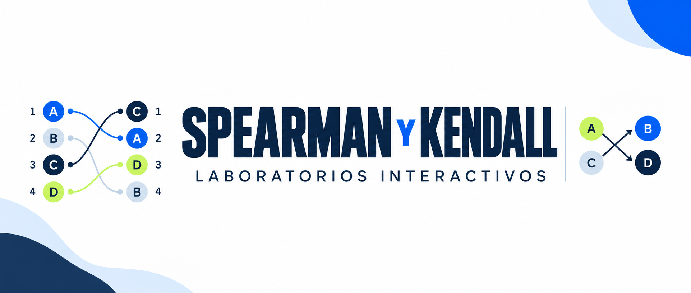

{.news-main-image}

Ya están disponibles dos laboratorios para aprender visualmente cómo funcionan las correlaciones de **Spearman y Kendall tau-b**. Podrán explorar posiciones en rankings, comparar personas de dos en dos e interpretar qué ocurre cuando cambia la relación entre las variables.

Al final encontrarán una actividad con seis situaciones para **elegir el coeficiente adecuado** según la pregunta de investigación y las escalas de medición. Los tres recursos están integrados en esta página: pueden utilizarlos directamente, sin abrir otra plataforma.

## Recordemos las escalas de medición 

Antes de elegir una correlación, revisemos qué información contienen las variables.

| Escala | ¿Qué nos permite hacer? | Ejemplos |
|:---|:---|:---|
| **Nominal** | Distinguir categorías **sin orden**. | País, sexo, nacionalidad. |
| **Ordinal** | Ordenar categorías, **sin asumir distancias iguales** entre ellas. | Nivel educacional, satisfacción, estatus social subjetivo. |
| **Intervalo** | Comparar **diferencias iguales**, sin un cero absoluto. | Temperatura en °C o °F. |
| **Razón** | Comparar diferencias y proporciones; **cero significa ausencia** de la cantidad. | Edad, ingreso en pesos, distancia, años de escolaridad. |

**Ojo:** los números no siempre son cantidades. `nivel_educ` (categorías ordenadas) es **ordinal**, mientras que `escolaridad` (cantidad de años) es **de razón**. 

## Spearman: correlación entre rankings {#sec-spearman}

### ¿Cuándo utilizamos Spearman?

**Spearman** permite estudiar si las personas que ocupan posiciones más altas en el ranking de una variable también tienden a ocupar posiciones más altas o más bajas en el ranking de otra. Para ello, compara las posiciones de las mismas personas en ambos ordenamientos, en lugar de trabajar directamente con los valores originales. Es útil con variables ordinales y también con variables cuantitativas cuando nos interesa una relación **monotónica** (al aumentar una variable, la otra tiende a aumentar o disminuir consistentemente, aunque no siga una línea recta).

Por ejemplo, podemos preguntar si las personas con más **años de escolaridad** tienden a ocupar posiciones más altas en el ranking de **ingresos**. Spearman evalúa hasta qué punto coinciden o se relacionan las posiciones de cada persona en ambos rankings.

Trabajaremos con cinco personas ficticias. Ambas variables son **ordinales**: las categorías se pueden ordenar, pero las distancias entre ellas no necesariamente son iguales.

- **Categorías de X:** 1 Básica incompleta · 2 Básica completa · 3 Media incompleta · 4 Media completa · 5 Educación superior.

- **Categorías de Y:** 1 Muy bajo · 2 Bajo · 3 Medio · 4 Alto · 5 Muy alto.

**Observe:** ¿las personas ocupan siempre la misma posición en ambas variables?

| Persona | Nivel educacional (X) | Estatus social subjetivo (Y) |
|:---|---:|---:|
| A | 1 | 1 |
| B | 2 | 3 |
| C | 3 | 2 |
| D | 4 | 5 |
| E | 5 | 4 |

::: {.callout-note}
**Lineal:** sigue aproximadamente una recta. **Monotónica:** mantiene una tendencia ascendente o descendente, aunque sea curva.
:::

### Exploremos qué hace Spearman

<section id="ec08-spearman" class="ec08-lab" aria-labelledby="ec08-s-heading">

<h3 id="ec08-s-heading">Laboratorio 1 · De valores a rankings</h3>
Escenario actual: <strong id="ec08-mode">Relación original</strong><button type="button" class="ec08-btn ec08-open-explore" data-ec08-s-open-drawer aria-controls="ec08-explore-drawer" aria-expanded="false">Explorar otras relaciones →</button>

<button class="ec08-step" type="button" data-s-step="1" aria-current="step">1 · Valores</button><button class="ec08-step" type="button" data-s-step="2">2 · Rankings</button><button class="ec08-step" type="button" data-s-step="3">3 · Interpretar</button>

Observa las cinco personas. ¿Quién tiene mayor nivel educacional? ¿Quién tiene mayor estatus subjetivo?

  
<h4>Los mismos casos, dos variables</h4>
<table class="ec08-table" aria-label="Valores y rankings de los cinco casos"><thead><tr><th scope="col">Persona</th><th scope="col">X</th><th class="ec08-rank-col" scope="col" hidden>Posición en X</th><th scope="col">Y</th><th class="ec08-rank-col" scope="col" hidden>Posición en Y</th></tr></thead><tbody id="ec08-spearman-tbody"><tr><th scope="row">A</th><td>1</td><td class="ec08-rank-col" hidden>1</td><td>1</td><td class="ec08-rank-col" hidden>1</td></tr><tr><th scope="row">B</th><td>2</td><td class="ec08-rank-col" hidden>2</td><td>3</td><td class="ec08-rank-col" hidden>3</td></tr><tr><th scope="row">C</th><td>3</td><td class="ec08-rank-col" hidden>3</td><td>2</td><td class="ec08-rank-col" hidden>2</td></tr><tr><th scope="row">D</th><td>4</td><td class="ec08-rank-col" hidden>4</td><td>5</td><td class="ec08-rank-col" hidden>5</td></tr><tr><th scope="row">E</th><td>5</td><td class="ec08-rank-col" hidden>5</td><td>4</td><td class="ec08-rank-col" hidden>4</td></tr></tbody></table>

Selecciona una persona para seguir sus valores.

  
<h4 id="ec08-s-visual-heading">Valores originales</h4><svg id="ec08-plot" viewBox="0 0 460 248" role="img" aria-label="Valores de las cinco personas"></svg>
Las barras muestran los códigos ordinales 1–5.

<fieldset><legend>¿Cómo esperas que se relacionen las posiciones en ambos rankings?</legend>
<label><input type="radio" name="ec08-s-guess" value="positiva"> Positivamente</label><label><input type="radio" name="ec08-s-guess" value="negativa"> Negativamente</label><label><input type="radio" name="ec08-s-guess" value="cero"> Cerca de cero</label>
</fieldset>
<button class="ec08-btn ec08-primary" type="button" id="ec08-s-reveal">Comprobar predicción</button>

<strong id="ec08-s-value">ρ = 0,800</strong>
Las posiciones altas en un ranking tienden a acompañarse de posiciones altas en el otro, sin coincidencia perfecta.

<button class="ec08-btn" id="ec08-s-back" type="button" disabled>← Anterior</button><button class="ec08-btn ec08-primary" id="ec08-s-next" type="button">Comparar rankings →</button>

<aside id="ec08-explore-drawer" class="ec08-explore-drawer" role="dialog" aria-modal="false" aria-labelledby="ec08-drawer-heading" aria-describedby="ec08-drawer-intro" hidden>

<h4 id="ec08-drawer-heading">Explorar otras relaciones</h4><button type="button" id="ec08-drawer-close" class="ec08-btn ec08-drawer-close" aria-label="Cerrar panel de exploración">×</button>

Cambia el orden de los cinco casos de Spearman y observa cómo varía su correlación.

<label for="ec08-drawer-guess">Antes de cambiar: ¿qué crees que ocurrirá con Spearman?</label><select id="ec08-drawer-guess"><option value="">Elige una predicción (si quieres)</option><option value="aumentan">Spearman aumentará</option><option value="signo">Cambiará el signo de la asociación</option><option value="disminuyen">Spearman disminuirá</option><option value="iguales">No cambiarán</option></select>

<button type="button" class="ec08-scenario-option" data-ec08-scenario="original" aria-pressed="true"><strong>Relación original</strong><small>Positiva con algunas inversiones del orden</small></button>
<button type="button" class="ec08-scenario-option" data-ec08-scenario="swap" aria-pressed="false"><strong>Mejor correspondencia</strong><small>Intercambiar las categorías de estatus de B y C</small></button>
<button type="button" class="ec08-scenario-option" data-ec08-scenario="reverse" aria-pressed="false"><strong>Relación negativa perfecta</strong><small>Invertir las categorías de estatus</small></button>
<button type="button" class="ec08-scenario-option" data-ec08-scenario="tie" aria-pressed="false"><strong>Relación con empates</strong><small>Asignar estatus subjetivo 3 a B y C</small></button>

<h5>¿Qué cambió respecto del original?</h5>
<table><thead><tr><th scope="col">Coeficiente</th><th scope="col">Original</th><th scope="col">Actual</th></tr></thead><tbody><tr><th scope="row">Spearman</th><td id="ec08-drawer-s-base">0,800</td><td id="ec08-drawer-s-value" class="ec08-drawer-value">0,800</td></tr></tbody></table>

En este coeficiente se observa una asociación positiva; el orden no coincide completamente.

Ordenar las filas de Spearman

<button type="button" class="ec08-btn" data-ec08-sort="original" aria-pressed="true">A–E</button><button type="button" class="ec08-btn" data-ec08-sort="x" aria-pressed="false">Por X</button><button type="button" class="ec08-btn" data-ec08-sort="y" aria-pressed="false">Por Y</button>

Ordenar filas no modifica los coeficientes.

<button type="button" class="ec08-btn ec08-drawer-reset" id="ec08-drawer-reset">↺ Volver a los datos originales</button>

</aside>
<noscript>
Sin JavaScript, usa los datos originales y el desplegable con rankings que sigue a este laboratorio.
</noscript>
</section>

::: {.callout-important title="¿Cómo interpretamos el resultado de Spearman?"}
En esta muestra, $\rho_s=0{,}80$ indica una **asociación positiva elevada entre las posiciones de ambos rankings**. Quienes tienen mayor nivel educacional tienden a ubicarse en posiciones más altas en el ranking de estatus subjetivo, aunque las posiciones no coinciden siempre.

> Este resultado describe únicamente los **cinco casos ficticios**. No demuestra causalidad ni permite generalizar a una población. 
:::

## Kendall: comparación entre pares {#sec-kendall}

### ¿Cuándo utilizamos Kendall?

**Kendall tau-b** compara personas **de dos en dos**: registra si sus órdenes **coinciden** (pares concordantes), se **invierten** (discordantes) o presentan **empates**. Es útil cuando interesa interpretar esas comparaciones, especialmente con escalas ordinales.

> **Spearman y Kendall pueden ser adecuados para las mismas variables.** Los empates no obligan a utilizar Kendall; tau-b ofrece una forma específica de considerarlos.

### Exploremos qué hace Kendall

<section id="ec08-kendall" class="ec08-lab" aria-labelledby="ec08-k-heading">

<h3 id="ec08-k-heading">Laboratorio 2 · Comparar dos personas</h3>
Escenario actual: <strong id="ec08-mode-k">Relación original</strong><button type="button" class="ec08-btn ec08-open-explore" data-ec08-k-open-drawer aria-controls="ec08-k-explore-drawer" aria-expanded="false">Explorar otras relaciones →</button>

Cinco personas ficticias; nivel educacional y estatus social subjetivo, con categorías ordenadas de 1 a 5. Kendall las compara de dos en dos: observa si el orden coincide, se invierte o presenta un empate.

<strong>Si una persona tiene mayor nivel educacional que otra, ¿también tiene mayor estatus subjetivo?</strong>

<button class="ec08-step" type="button" data-k-step="1" aria-current="step">1 · Observar</button><button class="ec08-step" type="button" data-k-step="2">2 · Clasificar</button><button class="ec08-step" type="button" data-k-step="3">3 · Coeficiente</button>

Observemos dos personas: ¿quién tiene mayor nivel educacional? ¿Quién tiene mayor estatus subjetivo?

<label for="ec08-pair-a">Persona 1</label><select id="ec08-pair-a"><option selected>A</option><option>B</option><option>C</option><option>D</option><option>E</option></select><label for="ec08-pair-b">Persona 2</label><select id="ec08-pair-b"><option>A</option><option selected>B</option><option>C</option><option>D</option><option>E</option></select>

 
<strong>Nivel educacional (X)</strong>

A<output id="ec08-x-val-a">1</output>

B<output id="ec08-x-val-b">2</output>

Mayor: B

 
<strong>Estatus subjetivo (Y)</strong>

A<output id="ec08-y-val-a">1</output>

B<output id="ec08-y-val-b">3</output>

Mayor: B

Mayor nivel educacional: B · Mayor estatus subjetivo: B.

<fieldset><legend>Tu clasificación del par</legend>
<label><input type="radio" name="ec08-k-guess" value="Concordante"> Concordante</label><label><input type="radio" name="ec08-k-guess" value="Discordante"> Discordante</label><label><input type="radio" name="ec08-k-guess" value="Empate"> Empate</label>
</fieldset>
Concordante: la misma persona tiene una categoría mayor en ambas variables. Discordante: una tiene mayor educación y la otra, mayor estatus. Empate: tienen la misma categoría en una variable o en ambas.

<button type="button" class="ec08-btn ec08-primary" id="ec08-pair-check">Comprobar respuesta</button>

Con cinco personas podemos formar diez pares distintos. Kendall considera las concordancias, discordancias y empates para resumir la asociación.

<strong id="ec08-count-n">10</strong><small>Pares totales</small>

<strong id="ec08-count-c">8</strong><small>Concordantes</small>

<strong id="ec08-count-d">2</strong><small>Discordantes</small>

<strong id="ec08-count-t">0</strong><small>Empates</small>

Pares totales = concordantes + discordantes + empatados: 10 = 8 + 2 + 0.

<button type="button" class="ec08-btn ec08-primary" id="ec08-k-reveal">Interpretar Kendall tau-b</button>

<strong id="ec08-k-value">τb = 0,600</strong>
8 − 2 = 6; 6/10 = 0,60.

0,600 no significa 60% de pares concordantes: son 8 de 10, es decir, el 80%.

¿Cómo se ajusta Kendall cuando hay empates?

τb = (C − D) / √[(C + D + TX)(C + D + TY)]

C: pares concordantes; D: discordantes; TX: empates solo en nivel educacional; TY: empates solo en estatus. Los empates en ambas variables no se suman a TX ni a TY.

Ver los 10 pares y su clasificación

<table class="ec08-table"><caption>Comparaciones con los valores actuales</caption><thead><tr><th scope="col">Par</th><th scope="col">Nivel educacional</th><th scope="col">Estatus subjetivo</th><th scope="col">Tipo</th></tr></thead><tbody id="ec08-pairs-tbody"><tr><th scope="row">A–B</th><td>A &lt; B</td><td>A &lt; B</td><td>Concordante</td></tr><tr><th scope="row">B–C</th><td>B &lt; C</td><td>B &gt; C</td><td>Discordante</td></tr></tbody></table>

<button type="button" id="ec08-k-back" class="ec08-btn" disabled>← Anterior</button><button type="button" id="ec08-k-next" class="ec08-btn ec08-primary">Clasificar este par →</button>

<aside id="ec08-k-explore-drawer" class="ec08-explore-drawer" role="dialog" aria-modal="false" aria-labelledby="ec08-k-drawer-heading" aria-describedby="ec08-k-drawer-intro" hidden>

<h4 id="ec08-k-drawer-heading">Explorar otras relaciones</h4><button type="button" id="ec08-k-drawer-close" class="ec08-btn ec08-drawer-close" aria-label="Cerrar panel de exploración">×</button>

Cambia el estatus de estas cinco personas y observa qué pares cambian de clasificación.

<label for="ec08-k-drawer-guess">Respecto del original, ¿qué crees que ocurrirá con Kendall?</label><select id="ec08-k-drawer-guess"><option value="">Elige una predicción (si quieres)</option><option value="aumentan">Kendall aumentará</option><option value="signo">Cambiará el signo de la asociación</option><option value="disminuyen">Kendall disminuirá</option><option value="iguales">No cambiará</option></select>

<button type="button" class="ec08-scenario-option" data-ec08-k-scenario="original" aria-pressed="true"><strong>Relación original</strong><small>Positiva con algunas inversiones del orden</small></button>
<button type="button" class="ec08-scenario-option" data-ec08-k-scenario="swap" aria-pressed="false"><strong>Mejor correspondencia</strong><small>Intercambiar las categorías de estatus de B y C</small></button>
<button type="button" class="ec08-scenario-option" data-ec08-k-scenario="reverse" aria-pressed="false"><strong>Relación negativa perfecta</strong><small>Invertir las categorías de estatus</small></button>
<button type="button" class="ec08-scenario-option" data-ec08-k-scenario="tie" aria-pressed="false"><strong>Relación con empates</strong><small>Asignar estatus subjetivo 3 a B y C</small></button>

<h5>¿Qué cambió respecto del original?</h5>
<table><thead><tr><th scope="col">Coeficiente</th><th scope="col">Original</th><th scope="col">Actual</th></tr></thead><tbody><tr><th scope="row">Kendall</th><td id="ec08-k-drawer-k-base">0,600</td><td id="ec08-k-drawer-k-value" class="ec08-drawer-value">0,600</td></tr></tbody></table>

Hay 8 pares concordantes y 2 discordantes: predominan los que coinciden en el orden.

<button type="button" class="ec08-btn ec08-drawer-reset" id="ec08-k-drawer-reset">↺ Volver a los datos originales</button>

</aside>
<noscript>
Sin JavaScript, consulta el recuento del ejemplo original en los desplegables posteriores.
</noscript>
</section>

::: {.callout-important title="¿Cómo interpretamos el resultado de Kendall?"}
En el escenario original, $\tau_b=0{,}60$ indica una **asociación ordinal positiva**. De diez pares posibles, ocho son concordantes y dos discordantes: habitualmente, quien tiene mayor nivel educacional también ocupa una categoría mayor de estatus subjetivo.

> **Importante:** 0,60 no significa 60% de pares concordantes. Aquí son **8 de 10**. El coeficiente tampoco demuestra causalidad ni debe compararse directamente con el valor de Spearman.
:::

::: {.callout-note title="¿Qué hace Kendall tau-b con los empates?"}
Kendall tau-b compara todos los pares de personas y los clasifica como concordantes, discordantes o empatados. Si dos personas tienen el mismo valor en una variable, ese par se considera un empate: no suma como concordante ni como discordante. Sin embargo, tau-b tiene en cuenta esos empates al ajustar el denominador de su fórmula. Así, el coeficiente refleja la asociación entre ambas variables considerando que algunos pares no pueden ordenarse completamente.
:::

## ¿Cómo elegimos el coeficiente? {#sec-elegir-coeficiente}

**Spearman y Kendall** permiten estudiar asociaciones entre variables ordenadas, pero utilizan procedimientos diferentes:

- **Spearman:** lo elegimos cuando queremos saber si las personas que ocupan posiciones más altas en una variable también tienden a ocupar posiciones más altas (o más bajas) en otra. Para ello, **compara las posiciones asignadas a las observaciones en dos rankings**.

- **Kendall tau-b:** lo elegimos cuando nos interesa comparar personas de dos en dos y observar si sus posiciones coinciden (**concordancia**), se invierten (**discordancia**) o presentan **empates**. Es especialmente útil con variables ordinales de pocas categorías, donde pueden existir muchos empates.

**¿Podemos utilizar ambos?** Sí. Los dos son adecuados para estudiar asociaciones ordinales. La elección depende de qué queremos analizar y de las características de los datos. Los empates **no obligan** a usar Kendall, pues Spearman también puede trabajar con posiciones empatadas (asignando la posición promedio a las observaciones en empate).

En nuestros cinco casos, **Spearman = 0,80** y **Kendall = 0,60**. Los resultados son distintos porque cada coeficiente resume el orden de manera diferente. No debemos comparar directamente sus valores para concluir que uno muestra una asociación más débil que el otro.

### ¿Cuándo conviene cada coeficiente?

Reconocer la escala es el primer paso. Después debemos considerar **qué relación queremos estudiar**.

| Coeficiente | ¿Cuándo conviene utilizarlo? |
|:---|:---|
| **Pearson** | Para estudiar una **relación lineal** entre variables cuantitativas. |
| **Spearman** | Para estudiar si las **posiciones en dos rankings** tienden a aumentar o disminuir juntas. |
| **Kendall tau-b** | Para estudiar la **concordancia entre pares**, considerando también los empates. |

**Recuerda:** la escala de medición orienta la elección, pero **no determina por sí sola** el coeficiente.

## ¿Qué correlación utilizarías? {#sec-juego-coeficientes}

En cada situación, **clasifica X e Y** (nominal, ordinal, intervalo o razón) y **elige un coeficiente**. La explicación indicará si existen otras respuestas válidas.

Situación 1 de 6

<h3 id="ec08-game-title">Reconoce las variables</h3>

  
<strong id="ec08-game-x-name">Variable X</strong><small id="ec08-game-x-description"></small><label for="ec08-game-x-level">Nivel de medición de X</label><select id="ec08-game-x-level"><option value="">Selecciona una opción</option><option value="nominal">Nominal</option><option value="ordinal">Ordinal</option><option value="intervalo">Intervalo</option><option value="razon">Razón</option></select>

  
<strong id="ec08-game-y-name">Variable Y</strong><small id="ec08-game-y-description"></small><label for="ec08-game-y-level">Nivel de medición de Y</label><select id="ec08-game-y-level"><option value="">Selecciona una opción</option><option value="nominal">Nominal</option><option value="ordinal">Ordinal</option><option value="intervalo">Intervalo</option><option value="razon">Razón</option></select>

<label for="ec08-game-coef-choice">¿Qué coeficiente o procedimiento elegirías para esta pregunta?</label><select id="ec08-game-coef-choice"><option value="">Selecciona una opción</option><option value="pearson">Pearson</option><option value="spearman">Spearman</option><option value="kendall">Kendall tau-b</option><option value="ninguno">Ninguno de estos tres</option></select>

<button type="button" id="ec08-game-check" class="ec08-game-main">Comprobar respuesta</button><button type="button" id="ec08-game-prev">← Anterior</button><button type="button" id="ec08-game-next" disabled>Siguiente situación →</button><button type="button" id="ec08-game-reset">↺ Reiniciar</button>

<h3>Recorrido completado</h3>
Para elegir una técnica, revisa <strong>las variables y la pregunta</strong>. Pearson estudia linealidad; Spearman, posiciones en rankings; Kendall, pares. Para comparar categorías sin orden, comienza con una tabla.

<strong>Intervalo:</strong> temperatura en °C; las diferencias son comparables, pero cero no es ausencia de temperatura.

<button type="button" id="ec08-game-repeat" class="ec08-game-main">Volver a practicar</button>

<noscript>
Para realizar el juego interactivo es necesario activar JavaScript. Puedes estudiar las situaciones de las tres bases disponibles en el práctico anterior y justificar tu elección por escrito.
</noscript>

**Actividad sin nota.** Al terminar puedes continuar con la aplicación de correlaciones en R del Práctico 8.

  <a href="../assignment/08-practico.html" class="course-resource-button" rel="noopener" aria-label="Continuar con los ejercicios del Práctico 8">Continuar con el Práctico 8 →</a>

