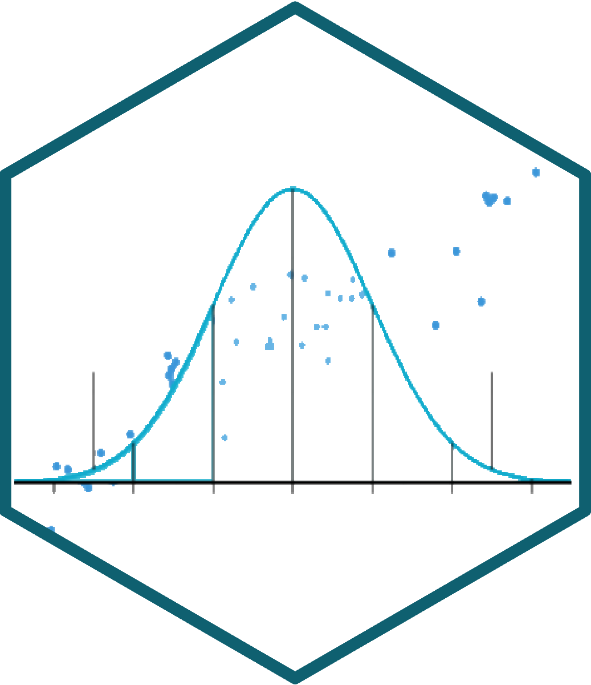
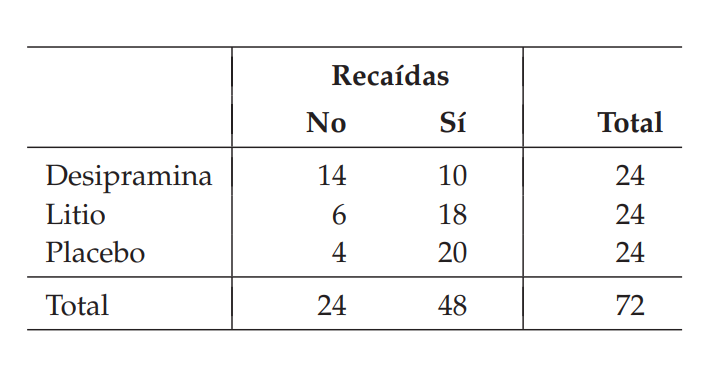
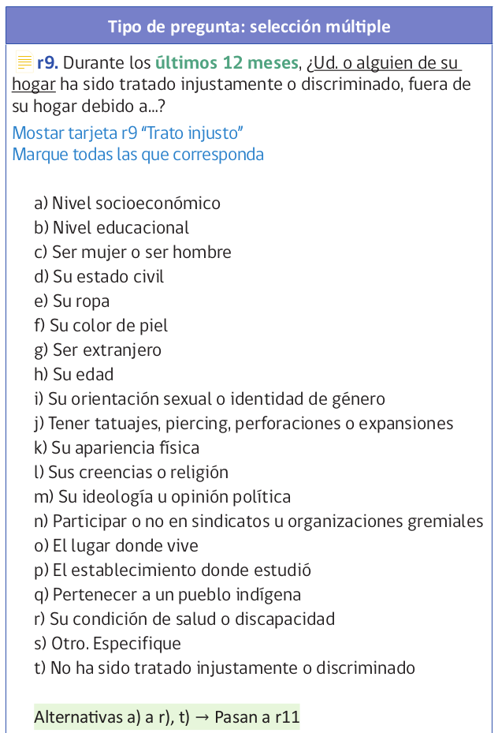
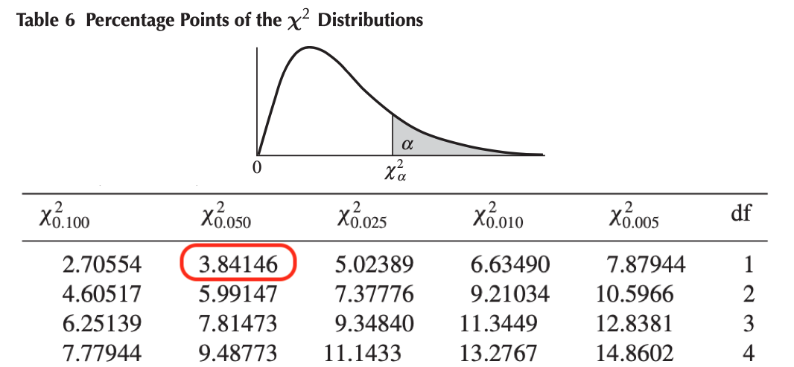

```{r setup}
#| include: false
pacman::p_load(tidyverse, kableExtra, sjmisc, sjPlot)
knitr::opts_chunk$set(warning = FALSE, message = FALSE, comment = "",
                       fig.width = 7, fig.height = 4.5, cache = TRUE, autodep = TRUE)
```

# {.hide-logo data-background-color="#0C3547"}

<br>

::::: columns
::: {.column width="30%"}

<br>

{width="100%" fig-align="right"}
:::

:::{.column width="2%"}

:::

::: {.column style="width: 65%; font-size: 25px; text-align: right; margin: 0 auto;"}

<br>

### [Estadística Correlacional]{style="font-size: 2em; color: white;"}

::: {style="border-top: 1px solid white; margin: 0.3em 0;"}
:::

[Inferencia, asociación, y reporte]{style="font-size: 1.5em; color: #dfc117;"}

[Juan Carlos Castillo]{style="font-size: 1em; color: white;"}\
[Sociología FACSO - UChile]{style="font-size: 1em; color: white;"}\
[2do Sem 2026]{style="font-size: 1em; color: white;"}

[correlacional.metodos-facso.org](https://correlacional.metodos-facso.org)

<br>
[**Sesión 11**:]{style="color: white; font-size: 1.3em;"}

[Asociación con variables categóricas 1]{style="color: #dfc117;"}

:::
:::::

# [¿Preguntas clase pasada?]{style="color: white;"} {data-background-color="#9B2626"}

# {data-background-color="#0C3547"}

::: {.nonincremental style="color: white; text-align: right; font-size: 1.3em;"}
[1. Correlación y variables categóricas]{style="color: #dfc117; font-weight: bold;"}

2\. Asociación en tablas de contingencia

3\. Chi cuadrado ($\chi^2$)
:::

## Correlación y categóricas {style="font-size: 0.85em;"}

- sentido original de correlación (Pearson): variables intervalares/razón, también se extiende a ordinal (Spearman)

- dadas las ventajas de este coeficiente, se puede extender su uso a variables con nivel de medición nominal **_con algunas consideraciones_**

- veamos un ejemplo:

## Ejemplo {style="font-size: 0.85em;"}

Tenemos las siguientes variables:

```{r}
#| echo: true
x <- c(0, 1, 1, 0, 0, 0, 1, 0, 1, 1, 0)
y <- c(12, 14, 17, 17, 11, 22, 23, 11, 19, 8, 12)
```

- Donde x sería una variable nominal dicotómica con valores 1 y 0, mientras que y es una variable continua (intervalar)

- Este tipo de correlación se denomina **punto biserial**

## Cálculo del coeficiente de correlación {style="font-size: 0.85em;"}

:::: {.columns}
::: {.column width="40%"}

::: {.content-box-red}
Se utiliza la función `cor.test()` para calcular la correlación punto biserial entre las dos variables

```{r}
#| echo: true
#| eval: false
cor.test(x, y)
```
:::
:::

::: {.column .fragment width="60%"}
```{r}
#| echo: false
cor.test(x, y)
```

::: {style="text-align: right; font-size: 0.8em;"}
(Se puede también usar `cor`, pero `cor.test` entrega más información)
:::
:::
::::

## Del output de R tenemos que: {style="font-size: 0.85em;"}

- la correlación punto biserial es **0.218**, indicando una relación positiva moderada entre ambas variables

- el valor **p** correspondiente es **0.5193**, que no permite rechazar la hipótesis nula con un 95% de confianza ya que el valor p no es menor a 0.05

- como complemento se entrega el intervalo de confianza **[-0.4391885  0.7233704]**, que como vemos contiene el **0**, y por lo tanto con un 95% de confianza no podemos decir que la correlación es distinta de 0

## ¿Qué es esta correlación? {style="font-size: 0.85em;"}

- no es más que una correlación de Pearson entre una variable nominal y una intervalar

- para diferenciarla de Pearson tradicional se le denomina correlación **punto biserial**

- hay que tener precauciones con su interpretación

## Interpretación {style="font-size: 0.85em;"}

- pensemos que x=0 es hombre, x=1 es mujer, y que y=nivel educativo, ¿cómo se interpreta la correlación?

  - **inferencia**: que existe (o no) una asociación entre ambas variables (según si es estadísticamente distinta de cero)
  - **tamaño**: que esta asociación es débil, mediana o fuerte
  - **sentido**: difícil de interpretar, ej: mientras "más mujer", mayor educación (?)

::: {.content-box-red .fragment}
Por lo tanto, esta correlación puede tener limitaciones en la interpretación de su **sentido**, sirve principalmente para inferencia y tamaño.
:::

## [¿Qué test / cálculo podría ser más apropiado para la relación entre una variable intervalar y una dicotómica?]{style="color: white;"} {data-background-color="#9B2626"}

## {style="font-size: 0.85em;"}

```{r}
#| echo: true
t.test(y ~ x, var.equal = TRUE)
```

## Por lo tanto, correlación punto-biserial {style="font-size: 0.85em;"}

- es equivalente a un test de diferencia de medias en términos de inferencia

- en términos de valor es igual que una correlación de Pearson: varía entre -1 y 1

- el apellido de (punto) **biserial** se utiliza solo para dar cuenta que el nivel de medición de una de las variables es nominal, y se requieren consideraciones especiales en su interpretación

- también se puede denominar biserial a una correlación entre una variable intervalar/razón y una ordinal

## {data-background-color="#0C3547"}

::: {.nonincremental style="color: white; text-align: center; font-size: 1.2em;"}
El sentido general de realizar correlaciones de Pearson con variables categóricas es el supuesto que la categórica representa distintos niveles de una **variable latente continua**

<br>

[Ej: 0=baja educación, 1=alta educación]{style="color: #dfc117;"}
:::

## Caso especial: correlación tetracórica {style="font-size: 0.85em;"}

- Es una correlación entre dos variables dicotómicas (=categórica de dos niveles)

- Se calcula en base a las frecuencias de cada combinación de valores (00,01,10,11).

- Supone que ambas variables son continuas y normalmente distribuidas antes de la categorización.

## Tipos de correlación según nivel de medición {style="font-size: 0.6em;"}

<br>

|                        | **Nominal Dicotómica** | **Nominal Politómica** | **Ordinal**                  | **Intervalar/Razón**         |
|------------------------|------------------------|------------------------|------------------------------|------------------------------|
| **Nominal Dicotómica** | Tetracórica            |                        | Biserial                     | Punto Biserial               |
| **Nominal Politómica** |                        |                        |                              |                              |
| **Ordinal**            | Biserial               |                        | Spearman, Kendall            | Pearson/biserial, Policórica |
| **Intervalar/Razón**   | Punto Biserial         |                        | Pearson/biserial, Policórica | Pearson                      |

# {data-background-color="#0C3547"}

::: {.nonincremental style="color: white; text-align: right; font-size: 1.3em;"}
1\. Correlación y variables categóricas

[2. Asociación en tablas de contingencia]{style="color: #dfc117; font-weight: bold;"}

3\. Chi cuadrado ($\chi^2$)
:::

## Escalas de medición de variables {style="font-size: 0.85em;"}

- NOIR: Nominal, Ordinal, Intervalar, Razón

::: {.fragment style="font-size: 0.85em;"}
| Tipo         | Características                      | Propiedad de números | Ejemplo           |
|--------------|--------------------------------------|----------------------|-------------------|
| *Nominal*    | Uso de números en lugar de palabras  | Identidad            | Nacionalidad      |
| *Ordinal*    | Números se usan para ordenar series  | + ranking            | Nivel educacional |
| *Intervalar* | Intervalos iguales entre números     | + igualdad           | Temperatura       |
| *Razón*      | Cero real                            | + aditividad         | Distancia         |
:::

::: {.notes}
- Nominal: Números empleados como etiquetas (ej. sexo, raza)
- Ordinales: Distintas categorías pueden ser ordenadas en serie. Posición, no distancia. (ej. cargos en una empresa)
- Intervalares: Escalas de unidades iguales. Diferencia entre dos números consecutivos refleja diferencia empírica. (ej. Horas del día)
- Razón: caracterizados por la presencia de un cero absoluto. (ej. frecuencias de eventos)
:::

## Tipos de datos en relación a escalas de medición {style="font-size: 0.85em;"}

- **Datos categóricos**:

  - pueden ser medidos sólo mediante escalas nominales, u ordinales en caso de orden de rango

- **Datos continuos**:

  - Medidos en escalas intervalares o de razón
  - Pueden ser transformados a datos categóricos

## Tablas de contingencia o tablas cruzadas {style="font-size: 0.85em;"}

:::: {.columns}
::: {.column width="50%"}
- Son tablas que presentan la distribución conjunta de dos o más variables

- Ej. Moore cap 9: recaídas en consumo de cocaína luego de tratar adicción con distintos tratamientos
:::

::: {.column width="50%"}
{fig-align="center" width="100%"}
:::
::::

::: {.notes}
- ver temas de frecuencias absolutas, porcentuales y totales por filas o por columnas
:::

## Tablas de contingencia y asociación {.nonincremental style="font-size: 0.85em;"}

<br>

:::: {.columns}
::: {.column width="50%"}
::: {.content-box-red style="text-align: center; font-size: 1.3em;"}
¿Cómo establecer una medida de **asociación** de los datos en una tabla de contingencia?
:::
:::

::: {.column .fragment width="50%"}
::: {.content-box-gray style="text-align: center; font-size: 1.3em;"}
¿Cómo saber si esa asociación es **estadísticamente** significativa?
:::
:::
::::

## Ejemplo {.nonincremental style="font-size: 0.85em;"}

Pensemos en la siguiente pregunta de investigación:

**¿Existe una asociación entre la percepción de ser discriminado y el nivel educacional?**

$H_a$: el nivel educacional se asocia a la percepción de ser discriminado

$H_0$: no hay asociación entre nivel educacional y percepción de ser discriminado

## Vamos a los datos: CASEN 2022 {style="font-size: 0.85em;"}

En CASEN existe una batería sobre percepción de discriminación:

::: {style="overflow: scroll; max-height: 500px;"}
{width="2000px"}
:::

## {style="font-size: 0.8em;"}

Generar subset CASEN con educación y percepción de discriminación

```{r}
#| echo: true
#| eval: false
pacman::p_load(haven, sjmisc, dplyr)
casen2022_chi <- read_dta("/home/juank/Downloads/Base de datos Casen 2022 STATA.dta")
summary(casen2022$r9)
sjmisc::find_var(data = casen2022_chi,"discriminado")
sjmisc::find_var(data = casen2022_chi,"nivel educacional")
casen2022_chi <- casen2022_chi %>%
  select(r9a:r9t, e6a)  # seleccionar variables
casen2022_chi <- casen2022_chi %>%
  rename("educacion"=e6a) #renombrar
save(casen2022_chi,
     file = "slides/data/casen2022_chi.Rdata") #guardar objeto
rm(list = c('casen2022_chi')) # quitar del environment por tamaño/memoria
```

## Recodificar discriminación {style="font-size: 0.8em;"}

```{r}
#| echo: true
pacman::p_load(sjmisc)
load("data/casen2022_chi.Rdata")
```

```{r}
#| include: false
# quitar clase haven_labelled (incompatible con vctrs actual), manteniendo etiquetas
casen2022_chi[] <- lapply(casen2022_chi, function(v) {
  class(v) <- setdiff(class(v), c("haven_labelled", "vctrs_vctr")); v
})
```

```{r}
#| echo: true
frq(casen2022_chi$r9t)
```

## {style="font-size: 0.85em;"}

- En la lista CASEN al final hay un ítem de "no ha sido discriminado" (**r9t**), que usaremos para nuestro análisis; la renombramos "discrim"

- Quienes responden sí son quienes no se han sentido discriminados, por lo tanto mejor cambiar las etiquetas para evitar confusiones

::: {.fragment}
```{r}
#| echo: true
casen2022_chi$discrim <- sjlabelled::set_labels(casen2022_chi$r9t,
            labels=c( "discriminad@"=0,
                      "no discriminad@"=1))
```
:::

## {style="font-size: 0.8em;"}

```{r}
#| echo: true
frq(casen2022_chi$discrim)
```

## Variable educación universitaria {style="font-size: 0.8em;"}

Ahora con la variable educación, recodificar universitario=1

```{r}
#| echo: true
casen2022_chi$educ_sup <- rec(casen2022_chi$educacion, rec = "1:12=0;13:15=1",
                              val.labels = c("Menos que universitaria", "Universitaria o más"))
frq(casen2022_chi$educ_sup)
```

## Tabla de frecuencias cruzadas {style="font-size: 0.8em;"}

:::: {.columns}
::: {.column width="40%"}
```{r}
#| echo: true
#| eval: false
pacman::p_load(sjPlot)
casen2022_chi %>%
  sjtab(educ_sup,
        discrim)
```
:::

::: {.column style="width: 60%; font-size: 0.6em;"}
```{r}
#| echo: false
pacman::p_load(sjPlot)
casen2022_chi %>%
  sjtab(educ_sup,
        discrim)
```
:::
::::

## Porcentajes por columna {style="font-size: 0.8em;"}

Para mayor claridad generamos porcentajes por columnas de la tabla (discriminación)

:::: {.columns}
::: {.column width="40%"}
```{r}
#| echo: true
#| eval: false
casen2022_chi %>%
  sjtab(educ_sup,
        discrim,
  show.col.prc = TRUE)
```
:::

::: {.column style="width: 60%; font-size: 0.6em;"}
```{r}
#| echo: false
casen2022_chi %>%
  sjtab(educ_sup,
        discrim,
  show.col.prc = TRUE)
```
:::
::::

## Porcentajes por fila {style="font-size: 0.8em;"}

Y acá por filas (educación)

:::: {.columns}
::: {.column width="40%"}
```{r}
#| echo: true
#| eval: false
casen2022_chi %>%
  sjtab(educ_sup,
        discrim,
  show.row.prc = TRUE)
```
:::

::: {.column style="width: 60%; font-size: 0.6em;"}
```{r}
#| echo: false
casen2022_chi %>%
  sjtab(educ_sup,
        discrim,
  show.row.prc = TRUE)
```
:::
::::

## Porcentajes por fila y columna {style="font-size: 0.8em;"}

:::: {.columns}
::: {.column width="40%"}
```{r}
#| echo: true
#| eval: false
casen2022_chi %>%
  sjtab(educ_sup,
        discrim,
  show.row.prc = TRUE,
  show.col.prc = TRUE)
```
:::

::: {.column style="width: 60%; font-size: 0.6em;"}
```{r}
#| echo: false
casen2022_chi %>%
  sjtab(educ_sup,
        discrim,
  show.row.prc = TRUE,
  show.col.prc = TRUE)
```
:::
::::

## {style="font-size: 0.8em;"}

:::: {.columns}
::: {.column style="width: 60%; font-size: 0.6em;"}
```{r}
#| echo: false
casen2022_chi %>%
  sjtab(educ_sup,
        discrim,
  show.row.prc = TRUE,
  show.col.prc = TRUE)
```
:::

::: {.column width="40%"}
<br>

::: {.content-box-red style="text-align: center; font-size: 1.3em;"}
¿Cómo saber si existe asociación o no entre estas variables?
:::
:::
::::

## {style="font-size: 0.85em;"}

Para simplificar, pensemos en una muestra más pequeña de 100 casos y además balanceada.

|                         | discriminad@ | no discriminad@ | Total |
|-------------------------|:------------:|:---------------:|:-----:|
| Menos que universitaria |              |                 | 50    |
| Universitaria o más     |              |                 | 50    |
| Total                   | 50           | 50              | 100   |

::: {.fragment style="text-align: center; font-size: 1.2em; color: #e50f0f;"}
_¿Cómo se deberían distribuir los casos en las celdas para constatar que hay (o no) diferencias?_
:::

## {style="font-size: 0.85em;"}

<br>

|                         | discriminad@ | no discriminad@ | Total |
|-------------------------|:------------:|:---------------:|:-----:|
| Menos que universitaria | 50           | 0               | 50    |
| Universitaria o más     | 0            | 50              | 50    |
| Total                   | 50           | 50              | 100   |

::: {.fragment}
Esta tabla estaría expresando lo esperado por nuestra **hipótesis (alternativa)**: existen diferencias al cruzar estas variables, y por lo tanto hay asociación entre educación y percepción de discriminación
:::

## {style="font-size: 0.85em;"}

Este es el otro extremo: todas las celdas tienen la misma cantidad de casos

|                         | discriminad@ | no discriminad@ | Total |
|-------------------------|:------------:|:---------------:|:-----:|
| Menos que universitaria | 25           | 25              | 50    |
| Universitaria o más     | 25           | 25              | 50    |
| Total                   | 50           | 50              | 100   |

::: {.fragment}
Esta tabla expresa la **hipótesis nula** $H_0$: no existe asociación entre variables
:::

# {data-background-color="#0C3547"}

::: {.nonincremental style="color: white; text-align: right; font-size: 1.3em;"}
1\. Correlación y variables categóricas

2\. Asociación en tablas de contingencia

[3. Chi cuadrado ($\chi^2$)]{style="color: #dfc117; font-weight: bold;"}
:::

## Prueba de $\chi^2$ {style="font-size: 0.85em;"}

- La prueba de $\chi^2$ (chi cuadrado) se utiliza para inferencia sobre asociación de variables categóricas en una tabla de contingencia

- $\chi^2$ se basa en un **test de diferencia**, donde se compara nuestra tabla de contingencia y una tabla donde no existe asociación entre variables, que representa la hipótesis nula $H_0$

- La lógica detrás es que si nuestra tabla es significativamente distinta de una tabla sin asociación, entonces podemos rechazar la hipótesis nula

## Pasos en el cálculo de $\chi^2$ {style="font-size: 0.85em;"}

- Generación de tabla de contingencia **observada** en base a nuestros datos

- Generación de tabla de contingencia **esperada** al azar en base a nuestros datos

- Establecer la diferencia entre lo observado y lo esperado al azar

- Establecer si esta diferencia es estadísticamente significativa

## Frecuencia esperada al azar en una tabla de contingencia {style="font-size: 0.85em;"}

<br>

|                         | discriminad@ | no discriminad@ | Total |
|-------------------------|:------------:|:---------------:|:-----:|
| Menos que universitaria | a            | b               | (a+b) |
| Universitaria o más     | c            | d               | (c+d) |
| Total                   | (a+c)        | (b+d)           | N     |

## Frecuencia esperada: celda **a** {style="font-size: 0.85em;"}

Nos enfocamos en la celda **a**, su frecuencia esperada es:

$$f_{e_{a}}=\frac{(a+b)(a+c)}{N}$$

::: {.fragment}
En base a los datos de nuestro ejemplo de 100 casos:

$$f_{e_{a}}=\frac{(50)(50)}{100}= \frac{2500}{100}=25$$
:::

::: {.fragment}
Por lo tanto, la frecuencia esperada **al azar** ($H_0$) para la celda **a**=25
:::

## Sentido general de la prueba de $\chi^2$ {style="font-size: 0.85em;"}

- La lógica de la prueba de Chi 2 es la comparación de las frecuencias observadas $(f_o)$ en nuestra tabla y de las frecuencias esperadas $(f_e)$ por azar

- Si nuestra tabla $(f_o)$ se diferencia **significativamente** del azar $(f_e)$, entonces podemos rechazar la hipótesis nula y tenemos evidencia de asociación entre variables

## {style="font-size: 0.85em;"}

:::: {.columns}
::: {.column width="35%"}
$$f_{e_{a}}=\frac{(a+b)(a+c)}{N}$$
$$f_{e_{b}}=\frac{(a+b)(b+d)}{N}$$
$$f_{e_{c}}=\frac{(a+c)(c+d)}{N}$$
$$f_{e_{d}}=\frac{(b+d)(c+d)}{N}$$
:::

::: {.column width="65%"}
::: {style="font-size: 0.8em;"}
|                         | discriminad@ | no discriminad@ | Total |
|-------------------------|:------------:|:---------------:|:-----:|
| Menos que universitaria | a            | b               | (a+b) |
| Universitaria o más     | c            | d               | (c+d) |
| Total                   | (a+c)        | (b+d)           | N     |
:::

::: {.fragment}
$$\chi^2=\sum\frac{(f_o-f_e)^2}{f_e}$$

El valor de Chi2 será mayor en la medida que lo observado sea distinto de lo esperado al azar
:::
:::
::::

## Frecuencias esperadas: ejemplo CASEN {style="font-size: 0.7em;"}

:::: {.columns}
::: {.column style="width: 55%; font-size: 0.7em;"}
```{r}
#| echo: false
casen2022_chi %>%
  sjtab(educ_sup, discrim)
```
:::

::: {.column .fragment width="45%" style="font-size: 0.7em;"}
$$f_{e_{a}}=\frac{168994*33472}{202231}=27970.8$$
$$f_{e_{b}}=\frac{168994*168759}{202231}=141023.2$$
$$f_{e_{c}}=\frac{33472*33237}{202231}=5501.2$$
$$f_{e_{d}}=\frac{168759*33237}{202231}=27735.8$$
:::
::::

## Frecuencias esperadas en R {style="font-size: 0.85em;"}

En R también es posible obtener las frecuencias esperadas por celda con la función `CrossTable` de la librería `gmodels`

```{r}
#| echo: true
#| eval: false
gmodels::CrossTable(casen2022_chi$educ_sup,
                    casen2022_chi$discrim,
                    expected=TRUE,
                    prop.r = FALSE,
                    prop.c=FALSE,
                    prop.chisq = FALSE,
                    prop.t = FALSE)
```

## {style="font-size: 0.7em;"}

```{r}
#| echo: false
gmodels::CrossTable(casen2022_chi$educ_sup, casen2022_chi$discrim,
                    prop.r = FALSE, prop.c = FALSE, prop.chisq = FALSE,
                    expected = TRUE, prop.t = FALSE)
```

## Cálculo de $\chi^2$ {style="font-size: 0.65em;"}

$$
\begin{aligned}
\chi^2&=\sum\frac{(f_o-f_e)^2}{f_e} \\ \\
&=\frac{(26996-27970.8)^2}{27970.8}+\frac{(141998-141023.2)^2}{141023.2}+\frac{(6476-5501.2)^2}{5501.2}+ \frac{(26761-27735.8)^2}{27735.8} \\ \\
&=\frac{(974.8)^2}{27970.8}+\frac{(974.8)^2}{141023.2}+\frac{(-974.8)^2}{5501.2}+ \frac{(-974.8)^2}{27735.8} \\ \\
&=\frac{950235.04}{27970.8}+\frac{950235.04}{141023.2}+\frac{950235.04}{5501.2}+ \frac{950235.04}{27735.8} \\ \\
&=33.97+6.74+172.7+34.3
\end{aligned}
$$

::: {.fragment style="font-size: 1.5em;"}
$$\chi^2=247.46$$
:::

## Inferencia y $\chi^2$ {style="font-size: 0.85em;"}

- Tal como en los pasos de la inferencia para pruebas anteriores (como $Z$ y $t$), para realizar la prueba de hipótesis comparamos el valor observado de $\chi^2$ con un valor crítico, que proviene de la distribución $\chi^2$

- además de especificar la probabilidad de error $\alpha$, se requiere especificar los **grados de libertad**

## Grados de libertad en $\chi^2$ {style="font-size: 0.85em;"}

- Como en la distribución $t$, $\chi^2$ también se ajusta por los grados de libertad, que se obtienen multiplicando el número de niveles/categorías -1 de cada variable

- En nuestro ejemplo de tabla de 2x2 (dos categorías de cada variable), los grados de libertad equivalen a:

::: {.fragment}
$$gl=(2-1)*(2-1)=1*1=1$$
:::

## {.nonincremental}

{fig-align="center" width="100%"}

## Comparación valor crítico y valor estimado {style="font-size: 0.85em;"}

- $\chi^2$ estimado: **247.46**

- $\chi^2$ crítico para un $\alpha=0.05$ y 1 grado de libertad: **3.84**

- En el ejemplo: **valor estimado $\chi^2$ > valor crítico $\chi^2$**

- Por lo tanto **se rechaza $H_0$**, podemos decir que hay evidencia de asociación entre percepción de discriminación y nivel educacional con un 95% de confianza

## $\chi^2$ directamente en R {style="font-size: 0.85em;"}

La función es `chisq.test()`

```{r}
#| echo: true
chisq.test(table(casen2022_chi$educ_sup,
                 casen2022_chi$discrim))
```

## $\chi^2$ en tablas de contingencia {style="font-size: 0.65em;"}

:::: {.columns}
::: {.column width="40%"}
De todas maneras, aparece directamente en varios outputs de tablas de contingencia en R, como la generada antes con `sjtab`, de librería `sjPlot`:

```{r}
#| echo: true
#| eval: false
casen2022_chi %>%
  sjtab(educ_sup,
        discrim,
  show.row.prc = TRUE)
```
:::

::: {.column style="width: 60%; font-size: 0.8em;"}
<br>

```{r}
#| echo: false
casen2022_chi %>%
  sjtab(educ_sup, discrim,
  show.row.prc = TRUE)
```
:::
::::

## Resumen: 5 pasos inferencia para tablas cruzadas {data-background-color="#0C3547" style="font-size: 0.85em;"}

::: {style="color: white;"}
1. Establecer las hipótesis

2. Calcular frecuencias esperadas

3. Estimar estadístico de prueba $\chi^2$

4. Establecer valor crítico de la prueba (de acuerdo a un cierto nivel de confianza y grados de libertad)

5. Contraste e interpretación
:::

## Resumen general: asociación bivariada y niveles de medición {.nonincremental style="font-size: 0.75em;"}

<br>

|                | Intervalar       | Ordinal                       | Nominal |
|----------------|------------------|-------------------------------|---------|
| **Intervalar** | Pearson          |                               |         |
| **Ordinal**    | Pearson/Spearman | Spearman                      |         |
| **Nominal**    | Punto-biserial   | Spearman/Punto-biserial/Chi 2 | Chi 2   |

# {.hide-logo data-background-color="#0C3547"}

<br>

::::: columns
::: {.column width="30%"}

<br>

{width="100%" fig-align="right"}
:::

:::{.column width="2%"}

:::

::: {.column style="width: 65%; font-size: 25px; text-align: right; margin: 0 auto;"}

<br>

### [Estadística Correlacional]{style="font-size: 2em; color: white;"}

::: {style="border-top: 1px solid white; margin: 0.3em 0;"}
:::

[Inferencia, asociación, y reporte]{style="font-size: 1.5em; color: #dfc117;"}

[Juan Carlos Castillo]{style="font-size: 1em; color: white;"}\
[Sociología FACSO - UChile]{style="font-size: 1em; color: white;"}\
[2do Sem 2026]{style="font-size: 1em; color: white;"}

[correlacional.metodos-facso.org](https://correlacional.metodos-facso.org)

:::
:::::
