```{r setup}
#| include: false
pacman::p_load(tidyverse, plotly, DT)
knitr::opts_chunk$set(warning = FALSE, message = FALSE, comment = "",
                       fig.width = 7, fig.height = 4.5, cache = TRUE, autodep = TRUE)

# Submuestra CASEN 2024 del repositorio de datos del curso
url_datos <- paste0("https://raw.githubusercontent.com/",
                    "cursos-metodos-facso/datos-ejemplos/main/casen_barrio2024.rdata")
load(url(url_datos))  # crea el objeto datos_casen
```

# {.hide-logo data-background-color="#0C3547"}

<br>

::::: columns
::: {.column width="30%"}

<br>

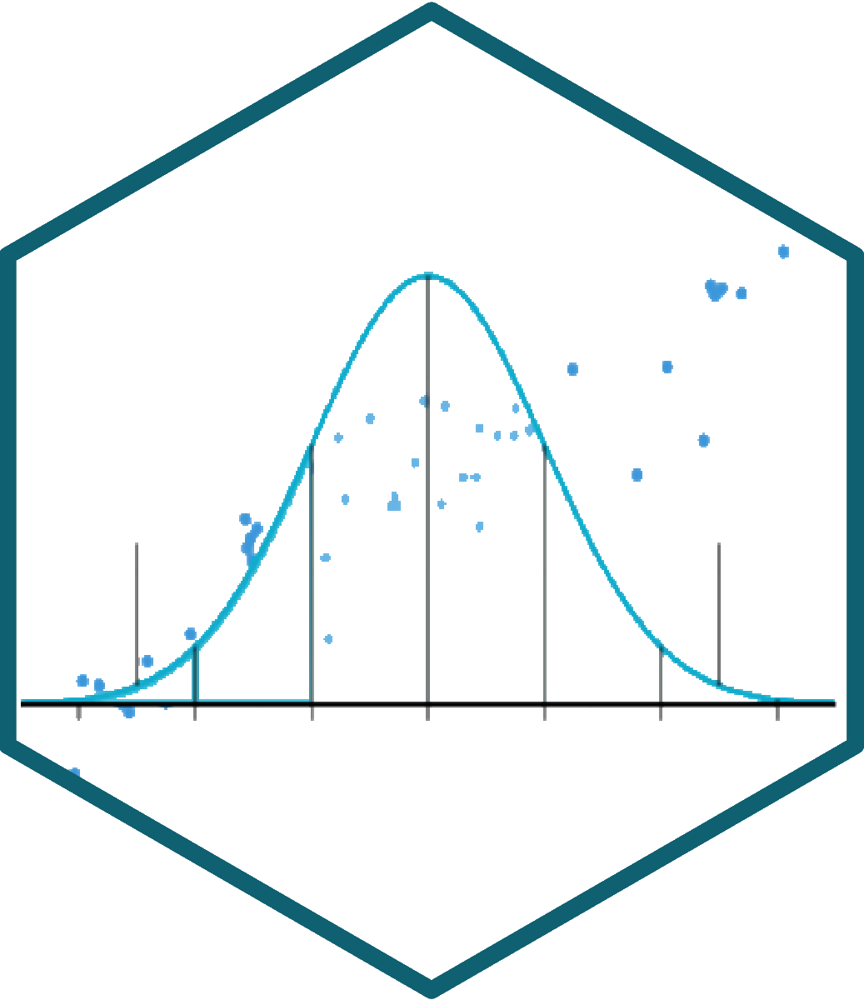{width="100%" fig-align="right"}
:::

:::{.column width="2%"}

:::

::: {.column style="width: 65%; font-size: 25px; text-align: right; margin: 0 auto;"}

<br>

### [Estadística Correlacional]{style="font-size: 2em; color: white;"}

::: {style="border-top: 1px solid white; margin: 0.3em 0;"}
:::

[Inferencia, asociación, y reporte]{style="font-size: 1.5em; color: #dfc117;"}

[Juan Carlos Castillo]{style="font-size: 1em; color: white;"}\
[Sociología FACSO - UChile]{style="font-size: 1em; color: white;"}\
[2do Sem 2026]{style="font-size: 1em; color: white;"}

[correlacional.metodos-facso.org](https://correlacional.metodos-facso.org)

<br>
[**Sesión 14**:]{style="color: white; font-size: 1.3em;"}

[Introducción a la escritura en documentos dinámicos en Quarto]{style="color: #dfc117;"}

:::
:::::

# {data-background-color="#0C3547"}

::: {.nonincremental style="color: white; text-align: right; font-size: 1.3em;"}

A\. Texto plano y Markdown

B\. Quarto

C\. Quarto en Positron

D\. ¿Qué se puede hacer en Quarto?

:::

# {data-background-color="#0C3547"}

::: {.nonincremental style="color: white; text-align: right; font-size: 1.3em;"}
[A. Texto plano y Markdown]{style="color: #dfc117; font-weight: bold;"}

B\. Quarto

C\. Quarto en Positron

D\. ¿Qué se puede hacer en Quarto?

:::

<!-- ## Ciencia abierta

<br>

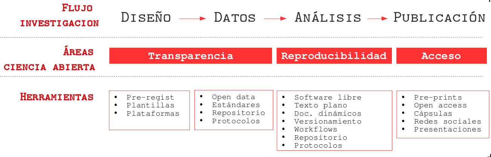

## {.hide-logo}

{width="80%" fig-align="center"}

## ¿Qué porcentaje de los estudios publicados son reproducibles?

::::: columns
::: {.column width="70%"}
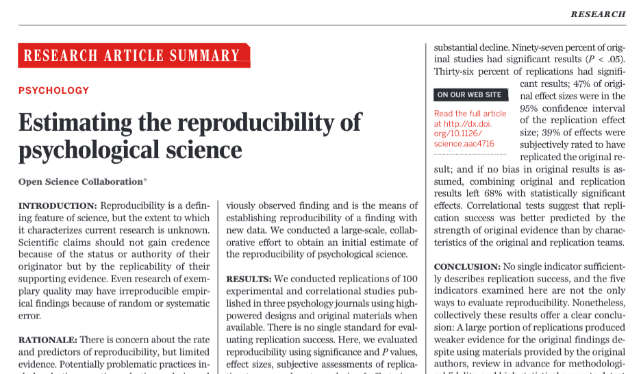{width="95%"}
:::

::: {.column width="30%"}
<br><br><br><br><br><br>

... alrededor de un **40%!** (... varía por disciplina)
:::
:::::

## {.hide-logo}

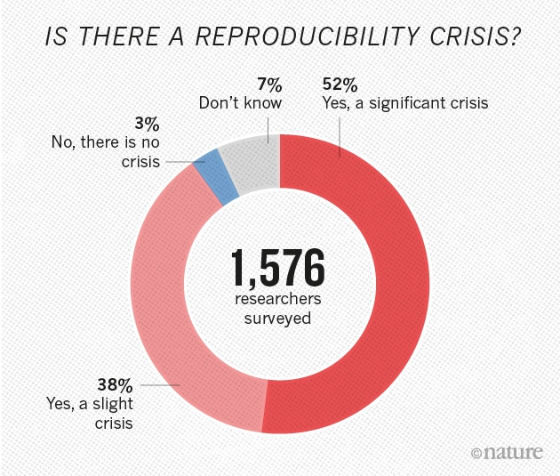{fig-align="center"}

::: {style="font-size: 0.6em; text-align: center;"}
Fuente: [Baker (2016) 1,500 scientists lift the lid on reproducibility - Nature](https://www.nature.com/news/1-500-scientists-lift-the-lid-on-reproducibility-1.19970)
:::

## {.hide-logo}

{fig-align="center"}

## Elementos para la [reproducibilidad]{style="color: #9B2626;"}

- Escritura abierta:

  - texto simple/plano, libre de software comercial
  - citas
  - documentos dinámicos

- Flujo de trabajo documentado y reproducible

- Carpeta de proyecto autocontenida y transferible

- Repositorio con datos y código de análisis abierto

- Control de versiones -->

## Flujo de trabajo con procesador de texto tradicional

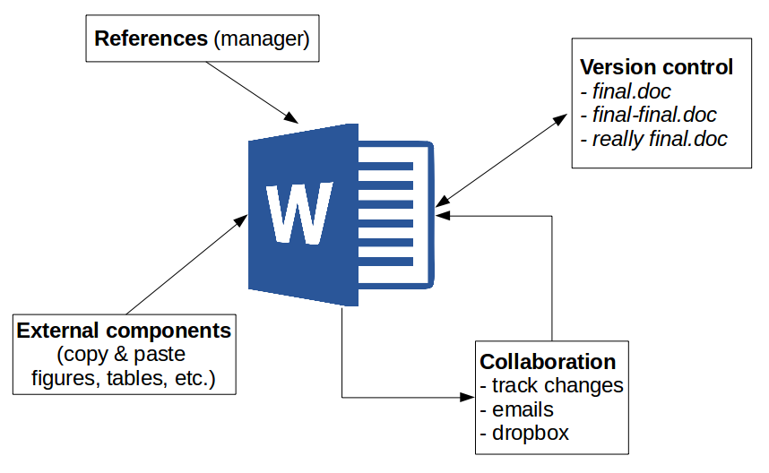{width="70%" fig-align="center"}

## Abriendo el archivo de escritura tradicional

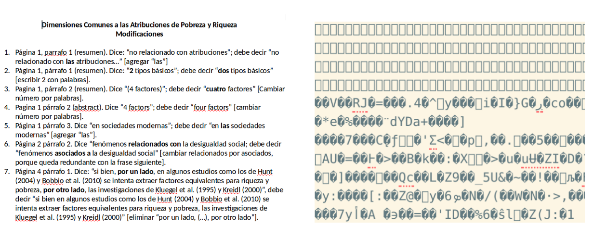

## Desventajas del procesador tradicional

:::: {.columns}
::: {.column width="65%"}

- Barrera de **pago/licencia** para acceder a los contenidos

- Difícil **versionamiento**: cuesta llevar registro de quién hizo qué cambio, lo que dificulta la reproducibilidad y la colaboración

- No permite un documento enteramente **reproducible** que combine el texto con el código de análisis

:::

::: {.column width="35%"}
<br>

{width="100%"}
:::
::::

## Un caso conocido: el reporte de una correlación

- Calculamos en R la correlación entre escolaridad e ingresos: **0.4335**

- Copiamos el número y el gráfico a un procesador de texto

- Detectamos un error en la base, o decidimos filtrar otros casos. Ahora el coeficiente es **0.362**

- ... y hay que **rehacer a mano** cada cifra, tabla y gráfico del informe

- ¿Cómo sabe un lector, nuestro equipo o nosotros mismo de dónde salió cada número?

# [Donde hay cortar/pegar, no hay reproducibilidad]{style="color: white;"} {data-background-color="#9B2626"}

## Escritura libre y abierta

::: {.content-box-red}
- independiente de programa comercial

- independiente de plataformas específicas

- permite combinar texto y análisis en un mismo documento

- foco en los contenidos en lugar del formato

- permite distintas opciones de formato final
:::

<!-- ## Inspiración

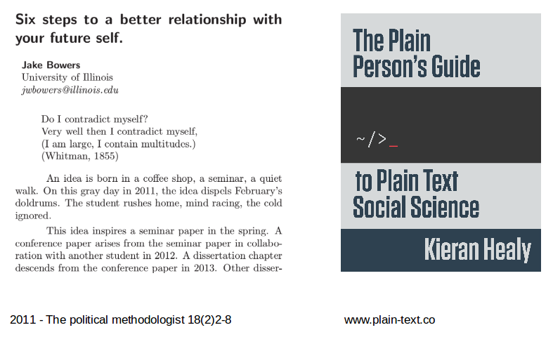{fig-align="center"} -->

## Escritura simple / plana

::: {.content-box-red}
- entorno: **editor de texto** (en nuestro caso, Positron)

- separación entre texto de entrada (*input*) y texto de salida (*output*)

- foco en el input/contenido vs. output/formato

- **marcas de edición**: vínculo entre el formato del input y del output

- sin cortar / pegar
:::

## Documentos dinámicos

- La escritura en texto plano permite la ejecución de **documentos dinámicos**

- Los documentos dinámicos integran **distintas formas de código** (de escritura y de análisis)

- Se evita la práctica no reproducible de **cortar/pegar**

- Mayor **eficiencia** al momento de corregir y volver a ejecutar los análisis

- Ejemplos: knitr, RMarkdown y... **Quarto**

<!-- ## Marcas de edición

Vínculo entre escritura en texto simple (input) y output

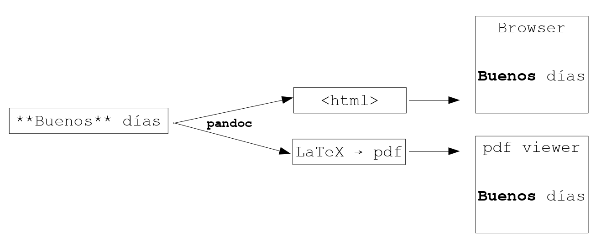 -->

## Principales alternativas escritura simple

::::: columns
::: {.column width="30%"}
### **LaTeX**

### [Markdown]{style="color: gray;"}
:::

::: {.column width="70%"}
- sistema de escritura simple de amplio uso en la academia

- alta calidad en salida a pdf

- creado a comienzos de los 80 (Donald Knuth, Leslie Lamport)
:::
:::::

## Principales alternativas escritura simple

::::: columns
::: {.column width="30%"}
### **LaTeX**

### [Markdown]{style="color: gray;"}
:::

::: {.column width="70%"}
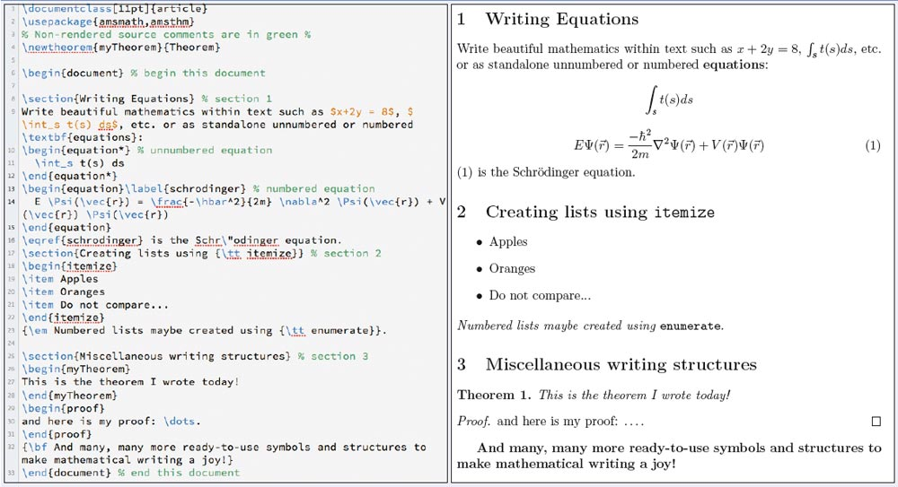
:::
:::::

## Principales alternativas escritura simple

::::: columns
::: {.column width="30%"}
### [LaTeX]{style="color: gray;"}

### **Markdown**
:::

::: {.column style="width: 70%;"}
- creado por John Gruber y Aaron Swartz en 2004

- forma de escritura simple con pocas marcas de formato

- conversión a distintos formatos de salida (html, pdf)

- soporta encabezados, tablas, imágenes, tablas de contenidos, ecuaciones, links ...

- filosofía: foco en contenido primero, el formato después
:::
:::::

## Principales alternativas escritura simple

::::: columns
::: {.column width="30%"}
### [LaTeX]{style="color: gray;"}

### **Markdown**
:::

::: {.column width="70%"}
{width="70%" fig-align="right"}
:::
:::::

## Principales alternativas escritura simple

::::: columns
::: {.column width="30%"}
### [LaTeX]{style="color: gray;"}

### **Markdown**
:::

::: {.column width="70%"}
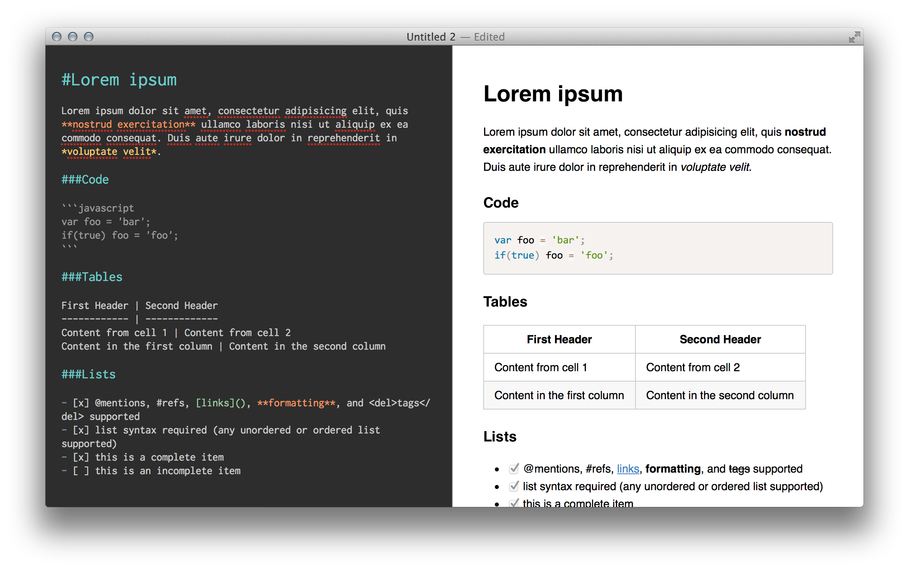{width="100%" fig-align="right"}
:::
:::::

## Principales alternativas escritura simple {.nonincremental}

<br>

|              | **Control de formato** | **Marcas de edición** | **Formatos de salida** |
|--------------|:----------------------:|:---------------------:|:----------------------:|
| **LaTeX**    |           \+           |          \+           |           \-           |
| **Markdown** |           \-           |          \-           |           \+           |

<!-- ## Markdown, pandoc y renderización

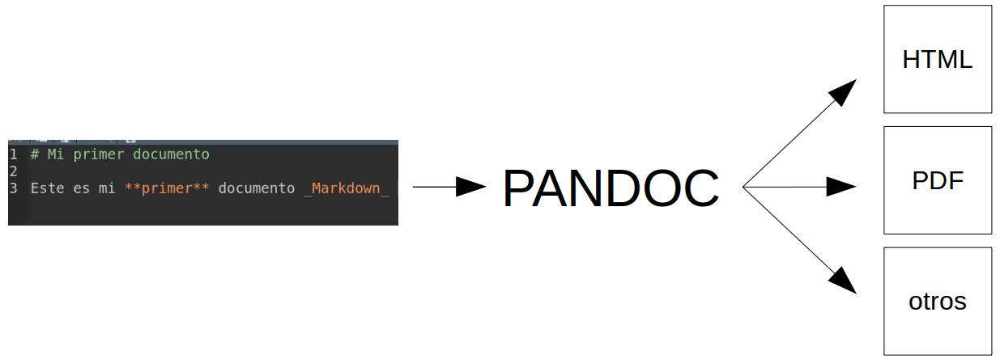{width="90%" fig-align="center"} -->

<!-- ## Ejemplos de marcas de edición en Markdown

::: {.content-box-red}
- Texto en **negrita** entre dos asteriscos: `**negrita**`

- Texto en *cursiva* con un asterisco por lado: `*cursiva*`

- Títulos se marcan con `#` al principio, subtítulos `##`, y así sucesivamente

- Imágenes: ``

- Links: `[](link-web)`
::: -->

<!-- ## Práctica {.nonincremental}

- [Tutorial de markdown online](https://www.markdowntutorial.com/es/)

- [Markdown cheatsheet](https://www.markdownguide.org/cheat-sheet/) -->

# {data-background-color="#0C3547"}

::: {.nonincremental style="color: white; text-align: right; font-size: 1.3em;"}
A\. Texto plano y Markdown

[B. Quarto]{style="color: #dfc117; font-weight: bold;"}

C\. Quarto en Positron

D\. ¿Qué se puede hacer en Quarto?

:::

<!-- ## Problemas de reproducibilidad en documentos de investigación

::::: columns
::: {.column width="50%"}
- Proceso tradicional: cortar y pegar resultados en el documento de texto

- Dificulta la **reproducibilidad**: ¿de dónde salieron esos resultados?
:::

::: {.column width="50%"}
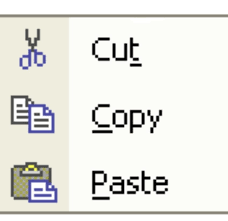{width="60%" fig-align="center"}
:::
::::: -->

## Desafiando el modelo cortar & pegar

::: {.content-box-red}
- **Ideal de reproducibilidad**: documento donde se combine texto y código que genera resultados presentados.

- **Limitación procesadores de texto**: no permiten incorporar código & resultados de manera eficiente

- **Limitación software de análisis**: permiten incorporar texto solo en un formato plano, no publicable
:::

## Quarto

:::: {.columns}
::: {.column width="70%"}

- Sistema de publicación científica y técnica **de código abierto**

- Sucesor de RMarkdown: misma lógica, más formatos y más lenguajes (R, Python, Julia)

- Se escribe en **texto plano**, en archivos `.qmd`

- Un mismo archivo puede producir HTML, PDF, Word, presentaciones, sitios web y libros

- **Viene incluido en Positron**: no hay que instalar nada adicional

:::

::: {.column width="30%"}
<br>

{width="100%"}
:::
::::

## ¿Cómo funciona?

```{mermaid}
%%| fig-width: 10
flowchart LR
  A[".qmd<br>texto + código"] --> B["knitr<br>ejecuta el código R"]
  B --> C[".md<br>texto + resultados"]
  C --> D["Pandoc<br>convierte"]
  D --> E["HTML"]
  D --> F["PDF"]
  D --> G["Word"]
  D --> H["Presentación"]
```

::: {.nonincremental}
- Todo esto ocurre al presionar un solo botón: **Preview (Ctrl+Shift+K)**
:::

## Anatomía de un archivo `.qmd` {.nonincremental}

:::: {.columns}
::: {.column width="58%"}

````markdown
---
title: "Escolaridad e ingresos en Chile"
author: "Nombre Apellido"
format: html
lang: es
---

## Introducción

Este informe usa datos de la **CASEN 2024**.

```{r}`r ''`
#| label: datos
load("input/data/casen_barrio2024.rdata")
```
````

:::

::: {.column width="42%"}

::: {.content-box-red}
**1. Encabezado YAML**: título, autor y formato de salida, entre dos líneas de tres guiones
:::

::: {.content-box-gray}
**2. Texto en Markdown**: lo que lee el lector
:::

::: {.content-box-green}
**3. Bloques de código** (*chunks*): código R que se ejecuta al generar el documento
:::

:::
::::

## Marcas de edición en Markdown {.nonincremental}

| Se escribe               | Se obtiene              |
|--------------------------|-------------------------|
| `## Resultados`          | Un título de sección    |
| `**asociación positiva**` | **asociación positiva** |
| `*Pearson*`              | *Pearson*               |
| `- primer punto`         | una lista con viñetas   |
| `[CASEN](https://...)`   | un enlace               |
| ``   | una imagen              |

## Opciones de los bloques de código {.nonincremental}

Se escriben al inicio del bloque, con `#|`

| Opción           | Qué hace                                         |
|------------------|--------------------------------------------------|
| `echo: false`    | muestra el resultado, oculta el código           |
| `eval: false`    | muestra el código, sin ejecutarlo                |
| `include: false` | ejecuta, pero no muestra ni código ni resultado  |
| `warning: false` | oculta advertencias                              |
| `fig-cap: "..."` | agrega una leyenda a la figura                   |
| `label: fig-...` | nombra el bloque y permite referirse a la figura |

<!-- # [RMarkdown]{style="color: white;"} {data-background-color="#9B2626"}

## RMarkdown: acepciones

::::: columns
::: {.column width="30%"}
{width="80%"}
:::

::: {.column width="70%"}
- Lenguaje que combina código (R) y texto (Markdown)

- Hoja de código escrita en RMarkdown (documento RMarkdown)

- Librería de R que provee de una serie de herramientas para generar documentos dinámicos y publicarlos
:::
:::::

## Librería RMarkdown

- Instalar la librería (o actualizarla, si está cargada): `install.packages("rmarkdown")`

- Al instalarla, también incorpora otras librerías (dependencies) que permiten trabajar y publicar con **RMarkdown** (como `knitr` y también `tinytex`, que permite generación de documentos pdf vía LaTeX).

## Escritura en RMarkdown

- permite incluir **trozos de código (chunks)** en el texto

- un chunk se especifica mediante una línea de código inicial ` ```{r}`, y se cierra con ` ``` `

::: {.fragment}
`Aquí texto`

````
```{{r}}
1 + 1
```
````

`Aquí sigue el texto`
:::

## Insertar chunks

Se pueden insertar rápidamente de la siguiente manera:

- Menú en ventana de RStudio *Insert* > R 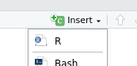{width="20%"}

- o, combinación `Ctrl + Alt + i`

# [Opciones de chunks]{style="color: white;"} {data-background-color="#9B2626"}

## Opciones (principales) de chunks

1. Mostrar código y resultado

2. Mostrar solo el código

3. Mostrar solo el resultado

4. No mostrar ni código ni resultado

5. Mostrar código sin ejecutarlo

6. Entregar resultado en formato directo (ej: html o latex)

## Especificación de opciones

- las opciones se anotan dentro de la llave inicial posterior a la letra r: `{r [opciones]}`

- las opciones principales son:

  - mostrar código `{r echo=TRUE/FALSE}`
  - mostrar resultado `{r results='markup'/'hide'}`

- estas opciones se visualizan al momento de procesar el documento en algún formato de salida. A este procesamiento se le denomina **renderizar** (del inglés _render_ ... no hay buena traducción)

## 1. Mostrar código y resultado (opción por defecto)

````
```{{r}}
1 + 1
```
````

(equivale a `{r echo=TRUE, results='markup'}`)

Renderiza:

```{r}
#| echo: true
1 + 1
```

## 2. Solo código, ocultando resultados

````
```{{r, results='hide'}}
1 + 1
```
````

Renderiza:

```{r}
#| echo: true
#| results: hide
1 + 1
```

## 3. Solo resultado

````
```{{r, echo=FALSE}}
1 + 1
```
````

Renderiza:

```{r}
#| echo: false
1 + 1
```

## 4. Ni código ni resultado

````
```{{r, echo=FALSE, results='hide'}}
1 + 1
```
````

No renderiza

Se usa cuando se ejecuta un comando necesario pero que no se requiere/necesita dejar visible en el documento de salida (Ej: cargar base de datos)

## 5. Código sin ejecutar

````
```{{r, eval=FALSE}}
1 + 1
```
````

Se puede usar para dar un ejemplo de código que no requiere ser ejecutado

## 6. Resultado en formato directo de salida

````
```{{r, results='asis'}}
stargazer(datos1, type="html")
```
````

- se utiliza principalmente para comandos de generación de tablas, que arrojan un código que luego puede ser interpretado por otro lenguaje (por ejemplo, html o LaTeX) -->

<!-- # [Quarto]{style="color: white;"} {data-background-color="#9B2626"}

## Documentos en Quarto

- Quarto es un programa que permite renderizar documentos que contienen código (texto y análisis) a distintos formatos, tales como documentos RMarkdown

- Está disponible para R en RStudio, pero funciona como un programa aparte también para otros lenguajes (ej: Python)

- El documento se genera al presionar el botón `render` (que activa función de la librería)

## {.hide-logo}

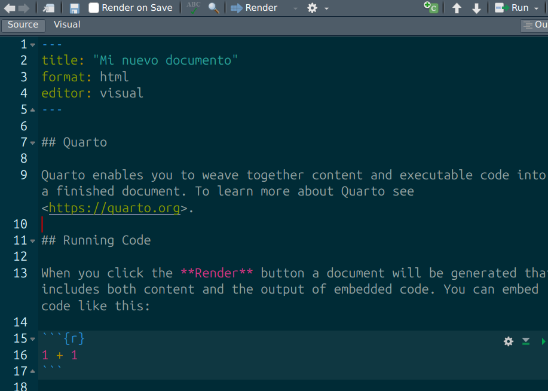{fig-align="center"}

## Generar documento en Quarto (.qmd)

- RStudio: File > New File > Quarto document

- se puede trabajar en modo visual o en código plano (source)

- al principio aparece una sección entre tres guiones (---) donde se especifican ciertas opciones del documento (se denomina YAML)

- el documento aparece con un texto y código de ejemplo que se puede luego borrar / reemplazar

## Sobre formatos de salida

::: {.content-box-green}
- La conversión más simple y rápida es a html.

- El resultado aparece en el visor (Viewer) de R, o se puede seleccionar otra opción de visualización desde la rueda de configuración al lado del botón `render`

- El documento queda grabado como archivo (ej: probando.html) en el mismo directorio del archivo .qmd
:::

## Resumen RMarkdown / Quarto {data-background-color="#0C3547" .nonincremental}

::::: columns
::: {.column style="width: 70%; color: white;"}
- Documentos dinámicos:

  - "tejiendo" texto y código de análisis en texto plano
  - reproducibilidad

- Documentos dinámicos en R / RStudio

  - RMarkdown
  - Quarto
  - chunks y opciones
:::

::: {.column width="30%"}
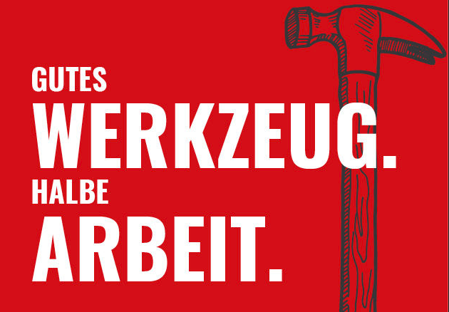
:::
:::::

# {data-background-color="#0C3547"}

::: {.nonincremental style="color: white; text-align: right; font-size: 1.3em;"}
A\. Reproducibilidad

B\. Texto plano y Markdown

C\. RMarkdown

[D. Protocolos reproducibles]{style="color: #dfc117; font-weight: bold;"}
:::

## ¿Cómo organizar el flujo de trabajo?

### A. Estilo personal (ad-hoc)

### B. Protocolo reproducible

## ¿Cómo organizar el flujo de trabajo?

::: {.content-box-red}
### [A. ad-hoc (menos reproducible)]{style="color: #9B2626;"}

- cada investigador define número de archivos, nombres, carpetas y organización

- explicar al resto cómo se organiza

- documentar en un archivo cómo se organiza

--> 

<!-- reproducibilidad y transparencia **LIMITADA**
:::

## ¿Cómo organizar el flujo de trabajo?

::: {.content-box-gray}
### [B. *Protocolo* de trabajo reproducible]{style="color: #9B2626;"}

- **estructura** de carpetas y archivos interconectados que refieren a reglas conocidas

- **autocontenido**: toda la información necesaria para la reproducibilidad se encuentra en la carpeta raíz o directorio de trabajo.
:::

## Estándares de reproducibilidad

{width="70%" fig-align="center"}

## Ejemplo protocolo reproducible: [TIER](https://www.projecttier.org/)

{width="60%" fig-align="center"}

## Protocolo TIER

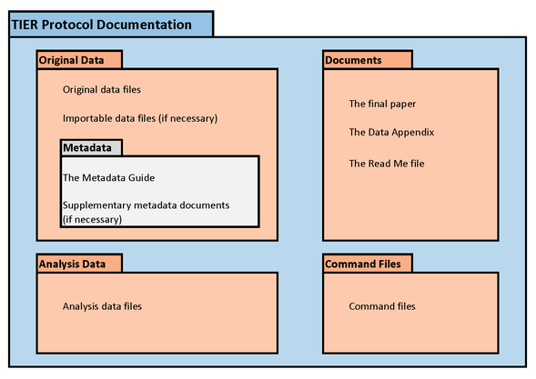{width="70%" fig-align="center"}

## {.hide-logo}

::: {style="text-align: center;"}
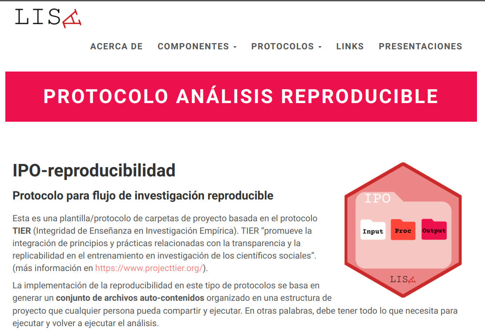{width="65%"}

### [https://lisa-coes.com/ipo-repro/](https://lisa-coes.github.io/ipo/)
:::

## Protocolo IPO - Estructura de archivos y carpetas

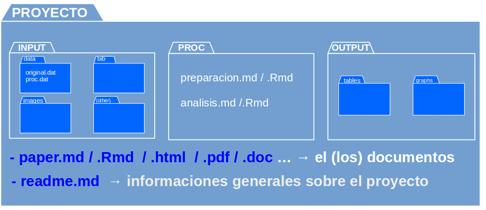{width="80%" fig-align="center"}

## Protocolo IPO en contexto R/RMarkdown

::: {.content-box-red}
- RMarkdown tiene una lógica en sí reproducible, y puede simplificar el uso de protocolos.

- Si todo el procesamiento se hace en el mismo documento paper.qmd, entonces basta con la carpeta input de IPO.

- Recomendación: realizar la preparación en código externo (carpeta proc) y el análisis en el paper.qmd.

- Es solo una **propuesta**, el sentido último es la reproducibilidad más que el cumplimiento estricto
:::

## Proyectos autocontenidos

- reproducible sin necesidad de archivos externos al directorio

- requisito: establecer **directorio de trabajo**

  - posición de referencia de todas las operaciones al interior del proyecto

  - también llamado **directorio raíz**

## Estableciendo directorio de trabajo

- forma tradicional en R:

  - `setwd(ruta-a-carpeta-de-proyecto)`

  - problemas: hace referencia a ruta local en el computador donde se está trabajando, por lo tanto no es reproducible y **se debe evitar**

- alternativa sugerida en R: **RStudio Projects**

## RStudio Projects

::: {.content-box-red}
- La funcionalidad **Projects** de RStudio permite establecer claramente un directorio de trabajo de manera eficiente

- Para ello, genera un archivo de extensión **.Rproj** en el directorio raíz de la carpeta del proyecto

- Luego se facilita acceder a la carpeta del proyecto en RStudio ejecutando desde el administrador de archivos del computador (file manager) el archivo **.Rproj**

- para comprobar, ejecutar `getwd()` y debería dar la ruta hacia la carpeta del proyecto
:::

## RStudio Projects

File -> New Project

::::: columns
::: {.column width="50%"}

:::

::: {.column width="50%"}

:::
:::::

## RStudio Projects

{fig-align="center"}

## Abriendo la sesión de RStudio como proyecto

<br>

- identificar en la carpeta respectiva el archivo .Rproj

- ejecutar y se abre R / RStudio desde ese directorio como raíz

## Resumen {data-background-color="#0C3547" .nonincremental}

::: {style="color: white;"}
- ciencia abierta y reproducibilidad

- texto plano y Markdown

- RMarkdown y documentos dinámicos

- protocolo de proyecto reproducible
:::

## {.hide-logo}

::: {style="text-align: center;"}
Más info:

## web: [lisa-coes.com](https://lisa-coes.com/)

## Github: [github.com/lisa-coes](https://github.com/lisa-coes)
:::

# {.hide-logo data-background-color="#0C3547"}

<br>

::::: columns
::: {.column width="30%"}

<br>

{width="100%" fig-align="right"}
:::

:::{.column width="2%"}

:::

::: {.column style="width: 65%; font-size: 25px; text-align: right; margin: 0 auto;"}

<br>

### [Estadística Correlacional]{style="font-size: 2em; color: white;"}

::: {style="border-top: 1px solid white; margin: 0.3em 0;"}
:::

[Inferencia, asociación, y reporte]{style="font-size: 1.5em; color: #dfc117;"}

[Juan Carlos Castillo]{style="font-size: 1em; color: white;"}\
[Sociología FACSO - UChile]{style="font-size: 1em; color: white;"}\
[2do Sem 2026]{style="font-size: 1em; color: white;"}

[correlacional.metodos-facso.org](https://correlacional.metodos-facso.org)

:::
::::: -->

# {data-background-color="#0C3547"}

::: {.nonincremental style="color: white; text-align: right; font-size: 1.3em;"}
A. Texto plano y Markdown

B\. Quarto

[C. Quarto en Positron]{style="color: #dfc117; font-weight: bold;"}

D\. ¿Qué se puede hacer en Quarto?

:::

## Nuestra pregunta

::: {.content-box-gray}
[¿Se asocia la escolaridad con el ingreso del trabajo en Chile?]{style="font-size: 1.4em; font-weight: bold;"}
:::

- **Datos**: CASEN 2024, submuestra aleatoria de `r format(nrow(datos_casen), big.mark = ".", decimal.mark = ",")` personas de 18 años o más ([repositorio de datos del curso](https://github.com/cursos-metodos-facso/datos-ejemplos))

- **Variables**: `escolaridad` (años), `ingreso_trabajo` (\$ mensuales), `edad` (años)

- **Ojo**: solo quienes trabajan reportan ingreso del trabajo

## Paso 0: la carpeta de trabajo

:::: {.columns}
::: {.column width="52%"}

- En Positron, **la carpeta es el proyecto**: *File › Open Folder...* 

- Proyecto **autocontenido**: todo está dentro de la carpeta

- Se evita `setwd("C:/Users/...")` y `.Rproj`

- Se usan **rutas relativas**: `input/data/...`

:::

::: {.column width="48%" .fragment}

```{.txt}
mi-informe/
├── informe.qmd
├── input/
│   └── data/
│       └── casen_barrio2024.rdata
└── output/
```
:::
::::

## Paso 1: crear el documento

:::: {.columns}
::: {.column width="45%"}

- *File › New File...* y elegir **Quarto Document**

- Escribir el encabezado YAML

- Presionar **Preview** (arriba a la derecha) o `Ctrl/Cmd + Shift + K`

:::

::: {.column width="55%" .fragment}

```yaml
---
title: "Escolaridad e ingresos en Chile"
author: "Nombre Apellido"
format: html
lang: es
---
```

:::
::::

## Paso 2: cargar los datos

::: {.nonincremental}
- Insertar un bloque de código: `Ctrl/Cmd + Shift + I`
:::

```{{r}}
#| label: datos
library(tidyverse)
load(url("https://raw.githubusercontent.com/cursos-metodos-facso/datos-ejemplos/main/casen_barrio2024.rdata"))  
# crea el objeto datos_casen
```

::: {.nonincremental}
- Ejecutar el bloque en la Consola: `Ctrl/Cmd + Shift + Enter` (o **Run Cell** sobre el bloque)

- Ejecutar solo una línea: `Ctrl/Cmd + Enter`
:::


## Paso 3: graficar la relación {.nonincremental}

:::: {.columns}
::: {.column width="50%"}

```{{r}}
#| label: fig-dispersion
#| fig-cap: "Escolaridad e ingreso del trabajo"
ggplot(datos_casen,
       aes(x = escolaridad,
           y = ingreso_trabajo)) +
  geom_jitter(alpha = 0.3, width = 0.3) +
  geom_smooth(method = "lm", se = FALSE) +
  labs(x = "Años de escolaridad",
       y = "Ingreso del trabajo ($)")
```

:::

::: {.column width="50%" .fragment}

```{r}
#| echo: false
ggplot(datos_casen,
       aes(x = escolaridad, y = ingreso_trabajo)) +
  geom_jitter(alpha = 0.3, width = 0.3) +
  geom_smooth(method = "lm", se = FALSE, color = "#9B2626") +
  scale_y_continuous(labels = scales::label_number(big.mark = ".")) +
  coord_cartesian(ylim = c(0, 3e6)) +
  labs(x = "Años de escolaridad", y = "Ingreso del trabajo ($)") +
  theme_minimal(base_size = 16)
```

:::
::::

## Paso 4: calcular r y reportarlo **sin escribirlo a mano** {.nonincremental}

```{r}
#| include: false
r <- cor(datos_casen$escolaridad, datos_casen$ingreso_trabajo,
         use = "complete.obs")
```

```{{r}}
#| label: correlacion
r <- cor(datos_casen$escolaridad, datos_casen$ingreso_trabajo,
         use = "complete.obs")
```

En el texto del documento se escribe:

```markdown
La correlación entre escolaridad e ingreso del trabajo es `r '\x60r round(r, 2)\x60'`.
```

::: {.fragment}
Y al generar el documento se lee:

::: {.content-box-green}
La correlación entre escolaridad e ingreso del trabajo es **`r round(r, 2)`**.
:::
:::

## Paso 5: generar el informe

- **Preview** o `Ctrl/Cmd + Shift + K`: el documento aparece en el panel **Viewer** de Positron

- El archivo `informe.html` queda grabado en la misma carpeta que `informe.qmd`

- Con **Render on Save** activado (barra del editor), el informe se actualiza cada vez que se guarda

- Si cambian los datos, se vuelve a generar y **todas las cifras se actualizan solas**

<!-- # [Desafío]{style="color: white;"} {data-background-color="#9B2626"}

::: {style="color: white; font-size: 0.9em;"}
Cambia `ingreso_trabajo` por `edad` en el gráfico y en `cor()`, y vuelve a generar el documento

1. ¿Cambió el número del texto sin que lo escribieras?
2. ¿Qué signo tiene ahora r y qué tan fuerte es la asociación?
3. ¿Qué proceso social de Chile podría explicarlo?
:::

::: {.notes}
Resultado esperado: r = `r round(cor(datos_casen$escolaridad, datos_casen$edad, use = "complete.obs"), 2)`. Las personas mayores tienen menos años de escolaridad: expansión educativa (efecto de cohorte, no del envejecimiento).
:::

## Si no se genera el documento, revisar primero {.nonincremental}

| Síntoma                               | Qué revisar                                                  |
|---------------------------------------|--------------------------------------------------------------|
| Error en un bloque                    | El mensaje indica el bloque: ejecutarlo solo con **Run Cell** |
| `object 'datos_casen' not found`      | El bloque que carga los datos debe ir antes que los demás    |
| `cannot open file`                    | La ruta relativa: ¿está la base en `input/data/`?            |
| El encabezado no funciona             | Dos líneas `---` y dos puntos después de cada campo          |
| r aparece como `NA`                   | Falta `use = "complete.obs"` en `cor()`                      | -->

# {data-background-color="#0C3547"}

::: {.nonincremental style="color: white; text-align: right; font-size: 1.3em;"}
1\. Escritura abierta y reproducibilidad

2\. ¿Qué es Quarto?

3\. Quarto en Positron

[4. ¿Qué se puede hacer en Quarto?]{style="color: #dfc117; font-weight: bold;"}
:::

## Un mismo `.qmd`, muchos formatos

:::: {.columns}
::: {.column width="50%"}

```yaml
---
title: "Escolaridad e ingresos"
format:
  html: default
  pdf: default
  docx: default
---
```

:::

::: {.column width="50%"}

::: {.nonincremental}
- `html`: página web (la más rápida)
- `pdf`: vía LaTeX o **Typst**
- `docx`: Word, para quien lo pida
- `revealjs`: presentación
- `dashboard`: panel de indicadores
:::

:::
::::

::: {style="font-size: 0.8em;"}
En Positron: **Quarto: Render Document** genera todos los formatos declarados.
:::

## Informes y artículos

- Informes de investigación, tesis y artículos académicos

- Numeración y referencias cruzadas: al escribir `@fig-dispersion` en el texto, aparece "Figura 1" con su enlace

- Ecuaciones en LaTeX:

. . .

$$
r = \frac{\sum (x_i - \bar{x})(y_i - \bar{y})}{(n-1)\, s_x\, s_y}
$$

## Referencias bibliográficas

- La bibliografía se guarda en texto plano: archivo **BibTeX** (`.bib`)

- Zotero + **Better BibTeX** exporta y actualiza el `.bib` automáticamente

- En el YAML: `bibliography: input/bib/referencias.bib`

- En el texto: `[@pardo2014]` → (Pardo, 2014), con la lista de referencias al final

- El estilo se cambia con un archivo `csl` (APA, Chicago...), sin reescribir nada

## Presentaciones

- **Esta presentación está hecha en Quarto** (`format: revealjs`)

- Todas las clases del curso son archivos `.qmd` 

- Los gráficos y resultados de las láminas se calculan al generar la presentación

- También se puedes generar presentaciones en PowerPoint (`pptx`) y Beamer (PDF)

## Sitios web y libros

:::: {.columns}
::: {.column width="50%"}

### Sitios web

- La [página del curso](https://correlacional.metodos-facso.org) es un sitio Quarto

- Varios `.qmd` + un archivo `_quarto.yml`

- Publicación gratuita en GitHub Pages o Quarto Pub

:::

::: {.column width="50%"}

### Libros

- Capítulos en archivos `.qmd` separados

- Salida en HTML, PDF y ePub

- Ejemplo: [R for Data Science (2.ª ed.)](https://r4ds.hadley.nz)

:::
::::

## Visualizaciones interactivas {.nonincremental}

::: {.panel-tabset}

### Gráfico

```{r}
#| echo: false
#| fig-height: 4.2
g <- datos_casen |>
  filter(!is.na(ingreso_trabajo), ingreso_trabajo <= 3e6) |>
  ggplot(aes(x = escolaridad, y = ingreso_trabajo, color = factor(mujer, labels = c("Hombre", "Mujer")))) +
  geom_jitter(alpha = 0.4, width = 0.3) +
  labs(x = "Años de escolaridad", y = "Ingreso del trabajo ($)", color = NULL) +
  theme_minimal()
ggplotly(g)
```

### Tabla

```{r}
#| echo: false
datos_casen |>
  select(edad, mujer, escolaridad, ingreso_trabajo, horas_trabajo) |>
  datatable(options = list(pageLength = 5), rownames = FALSE)
```

### Código

```{r}
#| echo: true
#| eval: false
library(plotly)
ggplotly(g)     # convierte un gráfico ggplot en interactivo

library(DT)
datatable(datos_casen)   # tabla con búsqueda y orden
```

:::

## Dashboards y diagramas

- **Dashboards** (`format: dashboard`): paneles de indicadores con gráficos, tablas y valores destacados

- **Diagramas** escritos como texto (Mermaid, Graphviz)

- **Shiny** y **Observable JS** para aplicaciones con filtros y controles: [VISLATAM](https://ocs-coes.shinyapps.io/visualizador-la/)

- Galería de ejemplos: [quarto.org/docs/gallery](https://quarto.org/docs/gallery/)

## Resumen {data-background-color="#0C3547"}

::: {style="color: white;"}
- **Escritura abierta**: texto plano, independiente de programas comerciales

- **Documentos dinámicos**: texto y código en un solo archivo, sin cortar/pegar

- **Quarto en Positron**: `.qmd` + Preview → informe reproducible

- Un mismo sistema para informes, presentaciones, sitios web, libros y visualizaciones interactivas
:::

## Recursos

::: {.nonincremental}
- [Quarto en Positron](https://quarto.org/docs/tools/positron/)

- [Guía de Markdown](https://www.markdownguide.org/cheat-sheet/)

- [Tutorial de Markdown en español](https://www.markdowntutorial.com/es/)

- [Better BibTeX para Zotero](https://retorque.re/zotero-better-bibtex/)

- [LISA: protocolos para investigación reproducible](https://lisa-coes.com/)
:::

# {.hide-logo data-background-color="#0C3547"}

<br>

::::: columns
::: {.column width="30%"}

<br>

{width="100%" fig-align="right"}
:::

:::{.column width="2%"}

:::

::: {.column style="width: 65%; font-size: 25px; text-align: right; margin: 0 auto;"}

<br>

### [Estadística Correlacional]{style="font-size: 2em; color: white;"}

::: {style="border-top: 1px solid white; margin: 0.3em 0;"}
:::

[Inferencia, asociación, y reporte]{style="font-size: 1.5em; color: #dfc117;"}

[Juan Carlos Castillo]{style="font-size: 1em; color: white;"}\
[Sociología FACSO - UChile]{style="font-size: 1em; color: white;"}\
[2do Sem 2026]{style="font-size: 1em; color: white;"}

[correlacional.metodos-facso.org](https://correlacional.metodos-facso.org)

:::
:::::
